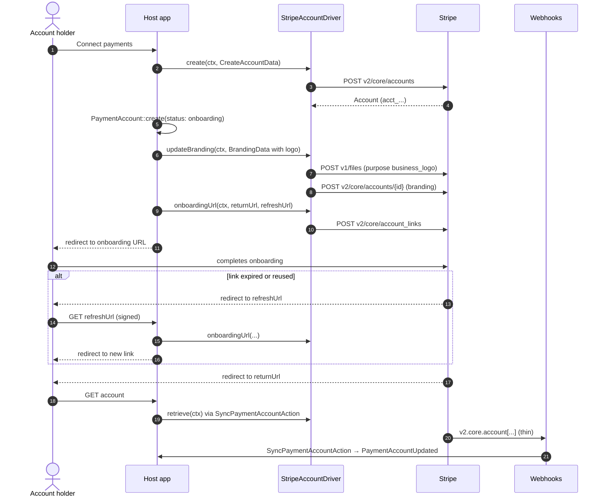

# Accounts and onboarding

[Home](Home.md) › Accounts and Onboarding

A merchant takes payments on its own **connected account** at the provider. With Stripe that is a Stripe Connect account created through the **Accounts v2** API.

## Contract

```php
interface ManagesAccounts
{
    public function create(PaymentContext $context, CreateAccountData $data): ProviderAccountData;
    public function retrieve(PaymentContext $context): ProviderAccountData;
    public function onboardingUrl(PaymentContext $context, string $returnUrl, string $refreshUrl): string;
    public function configuration(PaymentContext $context): AccountConfigurationData;
    public function updateBranding(PaymentContext $context, BrandingData $branding): AccountConfigurationData;
    public function updateLocales(PaymentContext $context, array $locales): AccountConfigurationData;
    public function dashboardUrl(PaymentContext $context): string;
}
```

Only `StripeAccountDriver` implements it. Get it with `Payments::accounts($context)`.

## The Stripe account model

`StripeAccountDriver` creates accounts with the **merchant configuration** and a **full Stripe dashboard**:

| Setting sent on create | Value | Effect |
| --- | --- | --- |
| `dashboard` | `full` | The account holder signs in to their own Stripe dashboard and owns the account. |
| `identity.country` | `payments.stripe.country` | Country of the business. |
| `configuration.merchant.capabilities.card_payments.requested` | `true` | Requests card payments. |
| `defaults.currency` | `payments.stripe.currency` | Default currency. |
| `defaults.responsibilities.fees_collector` | `stripe` | Stripe collects its fees from the account. |
| `defaults.responsibilities.losses_collector` | `stripe` | Stripe covers negative balances, not the platform. |
| `display_name`, `contact_email`, `metadata` | from `CreateAccountData` | |
| `include` | `configuration.merchant`, `identity`, `requirements` | Needed to map the response. |

Checkouts and refunds are **direct charges** on that account: every call passes `['stripe_account' => $accountId]`. The platform takes no application fee in the current code.

## Creating an account

```php
$data = Payments::accounts($context)->create($context, new CreateAccountData(
    displayName: 'Acme Workspaces',
    email: 'owner@example.com',
    metadata: ['merchant_id' => '42'],
    defaults: new AccountDefaultsData(
        statementDescriptor: 'ACME WORKSPACES',
        supportEmail: 'support@example.com',
        supportPhone: null,
        supportUrl: 'https://example.com/support',
        locales: ['en-US'],
        branding: new BrandingData(primaryColor: '#0A2D51', secondaryColor: '#F5A623'),
    ),
));
```

`create()` does not need `providerAccountId` in the context. It returns `ProviderAccountData`; **the package does not write a `payment_accounts` row**. The app creates the `PaymentAccount` and usually syncs it right away:

```php
$account = PaymentAccount::query()->create([
    'owner_type' => $owner->getMorphClass(),
    'owner_id' => (string) $owner->getKey(),
    'provider' => Provider::STRIPE,
    'provider_account_id' => $data->providerAccountId,
    'status' => PaymentAccountStatus::ONBOARDING,
    'connected_by' => $user->name,
]);

SyncPaymentAccountAction::make()->handle($account, $data); // no extra API call when data is passed
```

### CreateAccountData

| Property | Type | Notes |
| --- | --- | --- |
| `displayName` | `string` | Stripe `display_name`. |
| `email` | `?string` | Stripe `contact_email`. |
| `metadata` | `array<string, string>` | Stripe `metadata`. |
| `defaults` | `?AccountDefaultsData` | Merged into the create request with `array_replace_recursive`. |

### AccountDefaultsData

| Property | Type | Stripe field | Writable after onboarding |
| --- | --- | --- | --- |
| `statementDescriptor` | `?string` | `configuration.merchant.statement_descriptor.descriptor` | No (per the package's docblock) |
| `supportEmail` | `?string` | `configuration.merchant.support.email` | No |
| `supportPhone` | `?string` | `configuration.merchant.support.phone` | No |
| `supportUrl` | `?string` | `configuration.merchant.support.url` | No |
| `locales` | `list<string>` (e.g. `nl-NL`) | `defaults.locales` | Yes, `updateLocales()` |
| `branding` | `?BrandingData` | `configuration.merchant.branding` | Yes, `updateBranding()` |

`null` and empty values are filtered out, so they do not overwrite Stripe's defaults. The **logo** in `branding->logoPath` is ignored on create: a logo must be uploaded to an existing account, so call `updateBranding()` after `create()`.

"Not writable after onboarding" reflects how the driver is documented: once the account holder completes onboarding, they own those fields in their dashboard. The driver has no method to update them.

## Onboarding link

```php
$context = PaymentContext::forAccount(Provider::STRIPE, $account->provider_account_id);

$url = Payments::accounts($context)->onboardingUrl(
    $context,
    returnUrl: 'https://app.example.com/settings/payments',
    refreshUrl: URL::temporarySignedRoute('payments.onboarding.refresh', now()->addDay(), ['owner' => $ownerId]),
);
```

The driver calls `v2.core.accountLinks.create` with:

| Field | Value |
| --- | --- |
| `account` | `$context->requireAccount()` |
| `use_case.type` | `account_onboarding` |
| `use_case.account_onboarding.collection_options.fields` | `eventually_due` (collect everything up front) |
| `return_url` / `refresh_url` | the arguments |

The URL is **single-use** and short-lived.

- **Return URL:** where Stripe sends the account holder after they leave onboarding. Returning does not mean onboarding is complete; sync the account (or wait for a webhook) and check `status`.
- **Refresh URL:** where Stripe sends them when the link expired or was used already. That endpoint must create a **new** link and redirect to it. Protect it (the reference host app uses a temporary signed route), because anyone reaching it gets a fresh onboarding link for that account.



## Retrieving and status mapping

`retrieve()` calls `v2.core.accounts.retrieve` with `include: [configuration.merchant, identity, requirements]` and maps it to `ProviderAccountData`:

| Property | Source |
| --- | --- |
| `providerAccountId` | `account.id` |
| `status` | see below |
| `businessName` | `identity.business_details.registered_name`, falling back to `display_name` |
| `email` | `contact_email` |
| `capabilities` | `['payments' => card_payments.status, 'payouts' => stripe_balance.payouts.status]`, each `unrequested` when missing |
| `requirementsDue` | descriptions of requirement entries with `awaiting_action_from = user` and `minimum_deadline.status` in `currently_due` or `past_due` (an entry without `minimum_deadline` is left out) |

Status, first match wins:

| Condition | `PaymentAccountStatus` |
| --- | --- |
| `account.closed` is true | `DEACTIVATED` |
| `card_payments` status is `active` | `ACTIVE` |
| any user requirement currently or past due | `ONBOARDING` |
| otherwise | `RESTRICTED` |

| Status | Value | Meaning |
| --- | --- | --- |
| `ONBOARDING` | `onboarding` | Created; the account holder still has to provide information. |
| `ACTIVE` | `active` | Can take payments. |
| `RESTRICTED` | `restricted` | Onboarded, but the provider has disabled or not yet enabled payments (e.g. during verification). |
| `DEACTIVATED` | `deactivated` | No longer used by its owner; it still exists at the provider. |

## SyncPaymentAccountAction

`NetOS\Payments\Actions\SyncPaymentAccountAction` (a `lorisleiva/laravel-actions` action) copies the provider's view onto a `PaymentAccount`:

```php
SyncPaymentAccountAction::make()->handle(PaymentAccount $account, ?ProviderAccountData $data = null): PaymentAccount
```

1. Builds `PaymentContext::forAccount($account->provider, $account->provider_account_id)`.
2. Uses `$data` when given, otherwise calls `retrieve()`.
3. Fills `status`, `business_name`, `email`, `capabilities`, `requirements_due`, `synced_at = now()`.
   - When the local row has `deactivated_at`, `status` stays `DEACTIVATED` whatever the provider says.
4. Sets `activated_at = now()` the first time the provider reports `ACTIVE`.
5. Saves and dispatches `PaymentAccountUpdated`.

It runs from `ProcessWebhookEventJob` for account events, and from the app whenever it wants fresh state (the reference app re-syncs when the account screen is opened and the last sync is older than 30 seconds).

## Disconnecting and reconnecting

The package has no disconnect method. An owner can have several `payment_accounts` rows over time; the one without `deactivated_at` is current (`scopeCurrent()`). To disconnect, the app sets `deactivated_at` (and `status = deactivated`) on the row. The account keeps existing at Stripe, owned by the account holder. To reconnect, the app can clear `deactivated_at` on the latest row and sync it, instead of creating a new Stripe account.

## Configuration, branding and locales

### Reading the current configuration

```php
$config = Payments::accounts($context)->configuration($context); // AccountConfigurationData
```

| Property | Stripe field |
| --- | --- |
| `displayName` | `display_name` |
| `primaryColor`, `secondaryColor` | `configuration.merchant.branding.primary_color` / `secondary_color` |
| `hasLogo`, `hasIcon` | `branding.logo` / `branding.icon` not null |
| `statementDescriptor` | `configuration.merchant.statement_descriptor.descriptor` |
| `supportEmail`, `supportPhone`, `supportUrl` | `configuration.merchant.support.*` |
| `locales` | `defaults.locales` |
| `currency` | `defaults.currency` |

An app can compare this with its own standard and offer to fix differences (the reference app's "configuration check" does this; see [Host App Integration](Host-App-Integration.md)).

### Updating branding

```php
$config = Payments::accounts($context)->updateBranding($context, new BrandingData(
    primaryColor: '#0A2D51',
    secondaryColor: '#F5A623',
    logoPath: '/tmp/logo.png',   // readable local file of a PNG or JPG (no URLs)
));
```

1. When `logoPath` is set, the driver checks that it is a readable local file: a URL or stream wrapper (anything starting with `scheme://`), a missing or an unreadable file throws `RuntimeException('The logo must be a readable local file.')`. It opens the file, uploads it with `files.create(['purpose' => 'business_logo'])` and closes the handle again, also when the upload fails. The call is made **as the platform** (no `stripe_account`), so the file belongs to the platform account; Accounts v2 accepts a platform file id for the connected account's logo.
2. Updates `configuration.merchant.branding` with the non-null values (`primary_color`, `secondary_color`, `logo`).
3. Returns `configuration()`.

The driver does not delete `logoPath`; cleaning up temporary files is the caller's job. Stripe rejects logos that do not meet its requirements; the app should not let that block connecting (the reference app wraps it in `rescue()`).

### Updating locales

```php
Payments::accounts($context)->updateLocales($context, ['nl-NL']);
```

Sets `defaults.locales`, the language of Stripe's emails and invoices for that account, and returns `configuration()`.

## Dashboard URL

```php
$url = Payments::accounts($context)->dashboardUrl($context);
```

Returns `https://dashboard.stripe.com/test/dashboard` when the platform secret starts with `sk_test_` or `rk_test_` (secret and restricted test keys), otherwise `https://dashboard.stripe.com/dashboard`. It is not account-specific: the account holder signs in to their own dashboard. The method makes no API call and does not use the account id from the context.

## Sandbox vs live

There is no mode setting. The mode follows the platform secret in `STRIPE_SECRET`:

- a test (`sk_test_...`) key creates test connected accounts, test checkouts and test webhooks;
- webhook signing secrets are per event destination and per mode, so test and live need their own `STRIPE_WEBHOOK_SECRET` and `STRIPE_THIN_WEBHOOK_SECRET`;
- `dashboardUrl()` recognizes both the `sk_test_` and the `rk_test_` prefix.
