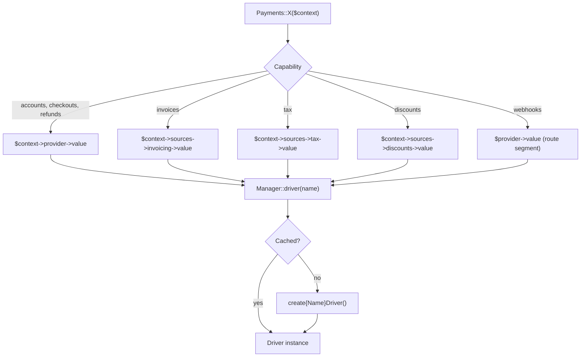
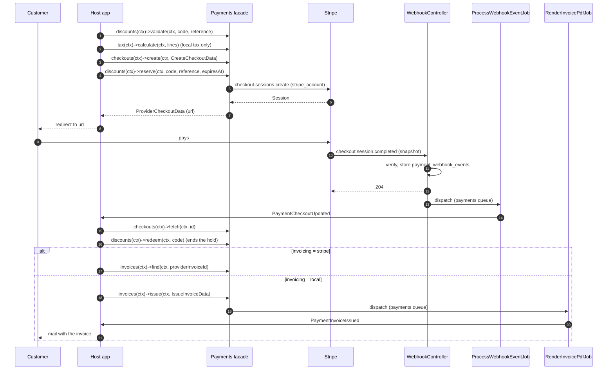
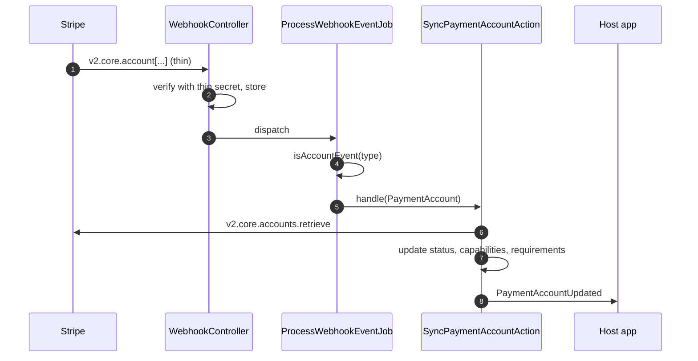

# Architecture

[Home](Home.md) › Architecture

## Layers

| Layer | Namespace | Role |
| --- | --- | --- |
| Entry point | `NetOS\Payments\Payments`, facade `NetOS\Payments\Facades\Payments` | One method per capability; picks the driver from the context. |
| Managers | `NetOS\Payments\Managers\*` | One `Illuminate\Support\Manager` per capability; creates and caches drivers. |
| Contracts | `NetOS\Payments\Contracts\*` | The interface every driver of a capability implements, plus the two contracts the host app implements. |
| Drivers | `NetOS\Payments\Drivers\Stripe\*`, `NetOS\Payments\Drivers\Local\*` | Talk to the provider or to the package's own tables. |
| Data | `NetOS\Payments\Data\*` | `spatie/laravel-data` DTOs in and out of drivers. |
| Enums | `NetOS\Payments\Enums\*` | Provider, sources, profiles, statuses, code types. |
| Models | `NetOS\Payments\Models\*` | Eloquent models of the package's tables, on the central or tenant connection. |
| Webhooks | `Http\Controllers\WebhookController`, `Jobs\ProcessWebhookEventJob` | Receive, store and process provider events. |
| Documents | `Http\Controllers\DocumentController`, `Jobs\RenderInvoicePdfJob`, view `payments::invoices.document` | Render local invoices and credit notes to PDF and serve them on signed routes. |
| Support | `NetOS\Payments\Support\DocumentNumberer`, `NetOS\Payments\Support\LocalDocumentPresenter` | Gapless numbering per series and year; a local document as `InvoiceData` with signed links. |
| Actions | `NetOS\Payments\Actions\SyncPaymentAccountAction` | Copies the provider's account state to `payment_accounts`. |
| Events | `NetOS\Payments\Events\*` | `PaymentCheckoutUpdated`, `PaymentAccountUpdated`, `PaymentInvoiceIssued` for the host app. |
| Exceptions | `NetOS\Payments\Exceptions\*` | `AccountNotConnectedException`, `HandledByCheckoutException`. |

## The entry point

`NetOS\Payments\Payments` is a singleton that receives the seven managers through its constructor. The facade `Payments` proxies to it.

```php
class Payments
{
    public function accounts(PaymentContext $context): ManagesAccounts;      // by provider
    public function checkouts(PaymentContext $context): ProcessesCheckouts;  // by provider
    public function refunds(PaymentContext $context): IssuesRefunds;         // by provider
    public function invoices(PaymentContext $context): ProvidesInvoices;     // by sources->invoicing
    public function tax(PaymentContext $context): CalculatesTax;             // by sources->tax
    public function discounts(PaymentContext $context): ManagesDiscountCodes;// by sources->discounts
    public function webhooks(Provider $provider = Provider::STRIPE): TranslatesWebhooks;
}
```

The context is used twice: once to pick the driver, and again as the first argument of every driver method. The driver uses it for the account id, the sources (the checkout driver reads all three), the issuer and the `urlParameters` of signed document links.

## One manager per capability

| Manager | Default driver | Drivers (`create{Name}Driver`) | Constructor input |
| --- | --- | --- | --- |
| `AccountManager` | `stripe` | `stripe` → `StripeAccountDriver` | `StripeClient`, `payments.stripe.country`, `payments.stripe.currency` |
| `CheckoutManager` | `stripe` | `stripe` → `StripeCheckoutDriver` | `StripeClient`, `new StripeTaxRates($stripe, payments.stripe.country)` |
| `RefundManager` | `stripe` | `stripe` → `StripeRefundDriver` | `StripeClient` |
| `InvoiceManager` | `stripe` | `stripe` → `StripeInvoiceDriver`, `local` → `LocalInvoiceDriver` | `StripeClient`; `DocumentNumberer`, `LocalDocumentPresenter`, `payments.local.invoice_number_prefix`, `payments.local.credit_note_number_prefix` |
| `TaxManager` | `stripe` | `stripe` → `StripeTaxDriver`, `local` → `LocalTaxDriver` | none; `payments.local.tax_country` |
| `DiscountCodeManager` | `stripe` | `stripe` → `StripeDiscountCodeDriver`, `local` → `LocalDiscountCodeDriver` | `StripeClient`; none |
| `WebhookManager` | `stripe` | `stripe` → `StripeWebhookDriver` | `payments.stripe.webhook_secrets.snapshot`, `.thin` |

Because they extend `Illuminate\Support\Manager`:

- a driver is created the first time it is requested and then cached in the manager for the lifetime of the manager (the managers are resolved once into the `Payments` singleton, so effectively for the lifetime of the process);
- drivers must therefore be stateless across merchants, which is why everything merchant-specific comes in through `PaymentContext`;
- custom drivers can be added with `extend()` (see [Extending](Extending.md)).

`StripeClient` is a container singleton built once from `payments.stripe.secret`. All Stripe calls on connected accounts pass `['stripe_account' => $accountId]` per request, so one client serves all merchants.

## How a driver is picked



Payment capabilities (accounts, checkouts, refunds) always run at the provider. Only invoicing, tax and discount codes can be `local`. Note that a `CapabilitySource` value (`stripe`) and a `Provider` value (`stripe`) are both used as manager driver names, so the `stripe` source maps onto the Stripe driver of that capability.

## How sources change what the provider does

The sources are read in two places:

1. `Payments` picks the invoices, tax and discount driver from them.
2. `StripeCheckoutDriver::create()` reads all three to build the Checkout Session:

| Source | `stripe` | `local` |
| --- | --- | --- |
| Invoicing | `invoice_creation.enabled` | No invoice in Checkout; the app issues one later with `LocalInvoiceDriver`. |
| Tax | `automatic_tax.enabled` (Stripe Tax) | Each line item with a `taxPercentage` gets an inclusive Stripe tax rate. |
| Discounts | The given promotion code in `discounts`, or `allow_promotion_codes` when none is given | Nothing; the app sends already-lowered line items. |

Whatever the sources, every session sets `customer_creation: always`, `billing_address_collection: required` and `tax_id_collection.enabled`, so `ProviderCheckoutData::$customer` holds the customer's billing details for either invoicing source.

The drivers of invoices, tax and discounts report this with `isHandledByCheckout()`. The app uses that to decide whether to do the work itself.

## The validity rule

Local invoicing needs local tax and local discounts, because a local invoice is built from amounts the app knows before the checkout. `CapabilitySourcesData::problem()` enforces it; the app calls `assertAllowed()` when it builds a context. See [Payment Context](Payment-Context.md).

## Request lifecycles

### Taking a payment



When the checkout expires instead, the app calls `discounts(ctx)->release(ctx, code, reference)`.

### Account updates



## Statelessness and long-running workers

- Drivers keep no per-merchant state. `PaymentContext` is a `final readonly` class.
- `StripeTaxRates` has no cache; it lists the account's tax rates on every call.
- `LocalTaxDriver::calculate()` caches rates per category only inside one call.
- `DocumentNumberer` and `LocalDocumentPresenter` hold no state; `RenderInvoicePdfJob` receives the document id and the context's `urlParameters`.
- The `StripeClient` singleton holds only the platform secret.

This is what makes the package safe to use from Octane workers and queue workers that serve many tenants.

## Directory layout

```
config/payments.php
database/migrations/                    central: payment_accounts, payment_webhook_events
database/migrations/tenant/             tenant: payment_discount_codes, payment_tax_rates, payment_invoices,
                                        payment_document_sequences (+ document and reservation columns)
resources/views/invoices/document.blade.php   invoice and credit note (page and PDF)
routes/webhooks.php                     POST {webhook_path}/{provider}
routes/documents.php                    GET {documents_prefix}/{document}, GET {documents_prefix}/{document}/pdf
src/
  Actions/SyncPaymentAccountAction.php
  Contracts/                            9 interfaces
  Data/                                 19 DTOs
  Drivers/Concerns/ValidatesDiscountCodes.php
  Drivers/Local/                        invoices, tax, discount codes
  Drivers/Stripe/                       accounts, checkout, discounts, invoices, refunds, tax, tax rates, webhooks
  Enums/                                7 enums
  Events/                               3 events
  Exceptions/                           2 exceptions
  Facades/Payments.php
  Http/Controllers/                     WebhookController, DocumentController
  Jobs/                                 ProcessWebhookEventJob, RenderInvoicePdfJob
  Managers/                             7 managers
  Models/                               6 models + UsesTenantConnection
  PaymentContext.php
  Payments.php
  PaymentsServiceProvider.php
  Support/                              DocumentNumberer, LocalDocumentPresenter
```
