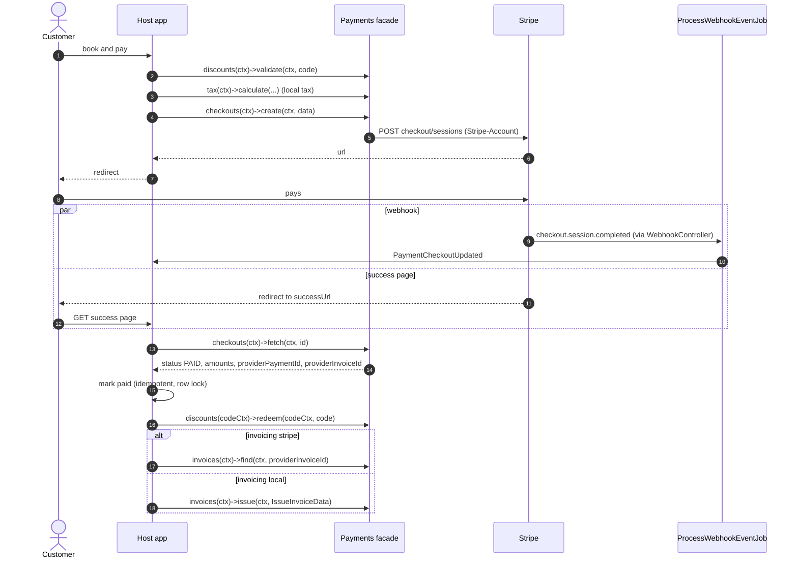

# Checkout

[Home](Home.md) › Checkout

A checkout is a hosted payment page on the merchant's account. With Stripe it is a **Stripe Checkout Session** created as a **direct charge** on the connected account.

## Contract

```php
interface ProcessesCheckouts
{
    public function create(PaymentContext $context, CreateCheckoutData $data): ProviderCheckoutData;
    public function fetch(PaymentContext $context, string $providerCheckoutId): ProviderCheckoutData;
    public function expire(PaymentContext $context, string $providerCheckoutId): ProviderCheckoutData;
}
```

Implemented by `StripeCheckoutDriver`. All three methods call `$context->requireAccount()` and send `['stripe_account' => $accountId]`.

## CreateCheckoutData

| Property | Type | Required | Notes |
| --- | --- | --- | --- |
| `lineItems` | `array<CheckoutLineItemData>` | yes | See below. |
| `currency` | `string` | yes | ISO code, lower case for Stripe (e.g. `eur`). Applied to every line. |
| `customerEmail` | `string` | yes | Prefills Checkout and is the receipt address. |
| `successUrl` | `string` | yes | Stripe `success_url`. |
| `cancelUrl` | `string` | yes | Stripe `cancel_url`. |
| `expiresAt` | `CarbonImmutable` | yes | Stripe `expires_at`. Must be 30 minutes to 24 hours from now, as Stripe requires; otherwise `create()` throws `InvalidArgumentException` before calling Stripe. |
| `providerDiscountId` | `?string` | yes (nullable) | A Stripe promotion code id (`promo_...`). Only used when discounts are `stripe`. |
| `description` | `string` | yes | PaymentIntent description and, with Stripe invoicing, invoice description. |
| `invoiceFooter` | `?string` | no | Footer of the Stripe invoice. |
| `metadata` | `array<string, string>` | no | Copied to the session, the PaymentIntent and the Stripe invoice. |

### CheckoutLineItemData

| Property | Type | Default | Notes |
| --- | --- | --- | --- |
| `description` | `string` | | Stripe `product_data.name`. |
| `unitAmount` | `int` | | Minor units, **including tax**. |
| `quantity` | `int` | `1` | |
| `taxPercentage` | `?float` | `null` | Inclusive rate. Required on every line when tax is not `stripe` (`create()` throws `InvalidArgumentException` for a line without one). Ignored when tax is `stripe`. |

Every price is sent with `tax_behavior: inclusive`: amounts always include tax, whichever source calculates it.

## How sources shape the session

```php
$params = [
    'mode' => 'payment',
    'line_items' => [...],            // price_data with currency, unit_amount, tax_behavior inclusive
    'customer_email' => ...,
    'payment_intent_data' => ['description' => ..., 'metadata' => ..., 'receipt_email' => ...],
    'success_url' => ..., 'cancel_url' => ..., 'expires_at' => ..., 'metadata' => ...,
    // Always, so a local invoice can show the same company details as Stripe's:
    'customer_creation' => 'always',
    'billing_address_collection' => 'required',
    'tax_id_collection' => ['enabled' => true],
];
```

| Source | Value | Added to the session |
| --- | --- | --- |
| Tax | `stripe` | `automatic_tax: { enabled: true }` |
| Tax | `local` | Per line: `tax_rates: [StripeTaxRates::inclusive($accountId, $percentage)]`. A line without a `taxPercentage` is refused before the session is created. |
| Invoicing | `stripe` | `invoice_creation: { enabled: true, invoice_data: { description, footer, metadata, rendering_options: { amount_tax_display: include_inclusive_tax } } }` (empty values filtered) |
| Invoicing | `local` | nothing |
| Discounts | `stripe`, `providerDiscountId` given | `discounts: [{ promotion_code: providerDiscountId }]` |
| Discounts | `stripe`, no `providerDiscountId` | nothing; Stripe's own code field is not offered |
| Discounts | `local` | nothing; send already-discounted `unitAmount`s |

### Receipt email

`payment_intent_data.receipt_email` is always set to `customerEmail`. Stripe then sends a receipt even when the account holder turned off receipt emails in their dashboard.

### Tax per line (local tax)

`StripeTaxRates::inclusive()` finds or creates an inclusive tax rate on the connected account for the percentage, so Stripe shows the VAT on the receipt and the Stripe invoice. See [Tax](Tax.md#inclusive-tax-rates-on-stripe).

## Using it

```php
$context = app(ResolvesPaymentContext::class)->current();
$discounts = Payments::discounts($context);
$tax = Payments::tax($context);

// Local discounts: lower the amounts first. Stripe discounts: send the full amount and the promotion code.
$amount = $discounts->isHandledByCheckout() ? $grossAmount : $discountedAmount;

// Local tax: know the rate before the checkout.
$taxPercentage = $tax->isHandledByCheckout()
    ? null
    : $tax->calculate($context, [new TaxableLineData('Desk', $amount, 'workspace_rental')])[0]->taxPercentage;

$checkout = Payments::checkouts($context)->create($context, new CreateCheckoutData(
    lineItems: [new CheckoutLineItemData('Desk', $amount, 1, $taxPercentage)],
    currency: 'eur',
    customerEmail: $email,
    successUrl: $successUrl,
    cancelUrl: $cancelUrl,
    expiresAt: CarbonImmutable::now()->addMinutes(31),
    providerDiscountId: $discounts->isHandledByCheckout() ? $code?->provider_discount_id : null,
    description: 'Desk booking',
));

$payment->update(['provider_checkout_id' => $checkout->providerCheckoutId]);

return redirect()->away($checkout->url);
```

Stripe API errors (`Stripe\Exception\ApiErrorException`) are not caught by the package; catch them in the app. Before calling Stripe, `create()` throws `InvalidArgumentException` when `expiresAt` is not 30 minutes to 24 hours ahead, or when tax is not `stripe` and a line has no `taxPercentage`.

## ProviderCheckoutData

Returned by `create()`, `fetch()` and `expire()`.

| Property | Type | Stripe source |
| --- | --- | --- |
| `providerCheckoutId` | `string` | `session.id` (`cs_...`) |
| `url` | `?string` | `session.url` (null once complete or expired) |
| `status` | `CheckoutStatus` | see below |
| `amountTotal` | `?int` | `amount_total`, minor units after discounts |
| `amountDiscount` | `?int` | `total_details.amount_discount` |
| `amountTax` | `?int` | `total_details.amount_tax` |
| `providerPaymentId` | `?string` | `payment_intent` id (`pi_...`), used for refunds |
| `providerInvoiceId` | `?string` | `invoice` id (`in_...`), only with Stripe invoicing |
| `customerName` | `?string` | `customer_details.name` |
| `metadata` | `array<string, string>` | `session.metadata` |
| `customer` | `?CustomerDetailsData` | `customer_details` (name, email, `business_name`, address, first tax id); `null` while the session has none. See [Invoices](Invoices.md#customer-details). |

### Status mapping

| Condition (first match) | `CheckoutStatus` |
| --- | --- |
| `payment_status` is `paid` or `no_payment_required` | `PAID` (`paid`) |
| `status` is `expired` | `EXPIRED` (`expired`) |
| otherwise | `OPEN` (`open`) |

A session that is `complete` but still `unpaid` (an asynchronous payment method that has not settled) maps to `OPEN`. The `checkout.session.async_payment_succeeded` webhook then triggers another fetch.

## fetch and expire

```php
$checkout = Payments::checkouts($context)->fetch($context, $checkoutId);
$checkout = Payments::checkouts($context)->expire($context, $checkoutId);
```

`expire()` calls Stripe's expire endpoint so the customer can no longer pay. Stripe refuses to expire a session that is already complete; the exception reaches the app. A common pattern is: fetch, and only expire when still `OPEN`. If the customer paid in the meantime, the returned status is `PAID`.

## End to end



The webhook and the success page can arrive in any order and both should run the same idempotent sync. The reference host app locks the payment row and only acts while it is still pending.

## Expiry and holds

The package checks that `expiresAt` is within Stripe's window (30 minutes to 24 hours from now) and passes it through. If the app holds stock (a desk, a seat) for an open checkout, it must release it itself when the checkout expires: on `checkout.session.expired` via `PaymentCheckoutUpdated`, and as a fallback when it sees an `OPEN` checkout past its expiry (expire it then). The reference app holds for 31 minutes, Stripe's 30 minute minimum plus a margin.

A local one-time discount code is held the same way: reserve it with `discounts($context)->reserve()` when creating the checkout and `release()` it when the checkout expires. See [Discount Codes](Discount-Codes.md#reserving).
