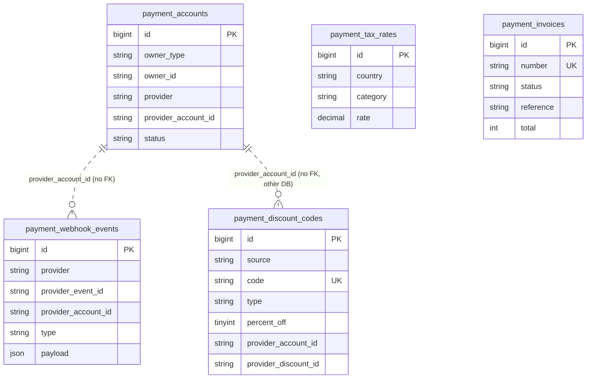

# Data model

[Home](Home.md) › Data Model

The package owns five tables. Two live on the **central** connection, three on the **tenant** connection.

There are no foreign keys between the package's tables: central and tenant tables can be in different databases, and the owner (`owner_type`, `owner_id`) is the app's model.

## Connections

| Table | Connection config | Model | How the connection is chosen |
| --- | --- | --- | --- |
| `payment_accounts` | `payments.connections.central` | `PaymentAccount` | `getConnectionName()`: config value, else the model default |
| `payment_webhook_events` | `payments.connections.central` | `PaymentWebhookEvent` | same |
| `payment_discount_codes` | `payments.connections.tenant` | `PaymentDiscountCode` | trait `UsesTenantConnection`: config value (`null` = default connection) |
| `payment_tax_rates` | `payments.connections.tenant` | `PaymentTaxRate` | `UsesTenantConnection` |
| `payment_invoices` | `payments.connections.tenant` | `PaymentInvoice` | `UsesTenantConnection` |

Central migrations call `Schema::connection(config('payments.connections.central'))`; tenant migrations return `config('payments.connections.tenant')` from `getConnection()`.

## Central tables

### payment_accounts

An account at a payment provider. An owner can have several over time; the one without `deactivated_at` is current.

Migration: `database/migrations/2026_11_04_000001_create_payment_accounts_table.php`

| Column | Type | Null | Purpose |
| --- | --- | --- | --- |
| `id` | bigint, PK | no | |
| `owner_type` | string | no | Morph class of the owner (tenant, team, ...). |
| `owner_id` | string | no | Owner key as string, so UUID and integer keys both fit. |
| `provider` | string | no | `Provider` value, e.g. `stripe`. |
| `provider_account_id` | string | no | e.g. Stripe `acct_...`. |
| `status` | string | no | `PaymentAccountStatus`: `onboarding`, `active`, `restricted`, `deactivated`. |
| `business_name` | string | yes | From the provider (registered name or display name). |
| `email` | string | yes | Contact email at the provider. |
| `capabilities` | json | yes | e.g. `{"payments": "active", "payouts": "pending"}`. |
| `requirements_due` | json | yes | Descriptions of what the holder still has to provide. |
| `connected_by` | string | yes | Free text set by the app (the reference app stores the user's name). |
| `synced_at` | timestamp | yes | Last `SyncPaymentAccountAction`. |
| `activated_at` | timestamp | yes | First time the provider reported `active`. |
| `deactivated_at` | timestamp | yes | Set by the app when it stops using the account. |
| `created_at`, `updated_at` | timestamps | yes | |

Indexes: unique `(provider, provider_account_id)`; index `(owner_type, owner_id)`.

Model `NetOS\Payments\Models\PaymentAccount`:

| Member | Description |
| --- | --- |
| `$guarded = ['id']` | Everything else is mass assignable. |
| casts | `provider` → `Provider`, `status` → `PaymentAccountStatus`, `capabilities` and `requirements_due` → array, timestamps → datetime |
| `owner(): MorphTo` | The app model that owns the account. |
| `scopeForOwner(Builder, Model $owner)` | `owner_type = $owner->getMorphClass()` and `owner_id = (string) $owner->getKey()` |
| `scopeCurrent(Builder)` | `deactivated_at` is null |

### payment_webhook_events

The inbox of verified provider events.

Migration: `database/migrations/2026_11_04_000002_create_payment_webhook_events_table.php`

| Column | Type | Null | Purpose |
| --- | --- | --- | --- |
| `id` | bigint, PK | no | Passed to `ProcessWebhookEventJob`. |
| `provider` | string | no | |
| `provider_event_id` | string | no | e.g. `evt_...`. |
| `provider_account_id` | string | yes | Connected account; `null` for platform events (skipped). |
| `type` | string | no | Event type. |
| `payload` | json | no | Full decoded body. May contain customer personal data. |
| `attempts` | unsigned int, default 0 | no | Incremented at the start of each processing run. |
| `exception` | text | yes | Last exception as string (with trace). |
| `processed_at` | timestamp | yes | Set on success; processed rows are never processed again. |
| `failed_at` | timestamp | yes | Last failure; cleared on success. |
| `created_at`, `updated_at` | timestamps | yes | |

Index: unique `(provider, provider_event_id)` (deduplication).

Model `PaymentWebhookEvent`: `$guarded = ['id']`; casts `provider` → `Provider`, `payload` → array, `processed_at`/`failed_at` → datetime.

## Tenant tables

### payment_discount_codes

Discount codes of both sources. A Stripe code mirrors a coupon with a promotion code; a local code exists only here. The mirror keeps what Stripe has no field for: the description and the start date.

Migration: `database/migrations/tenant/2026_11_05_000001_create_payment_discount_codes_table.php`

| Column | Type | Null | Purpose |
| --- | --- | --- | --- |
| `id` | bigint, PK | no | |
| `source` | string | no | `CapabilitySource`: `stripe` or `local`. Validation only matches the context's source. |
| `name` | string | no | Internal name. |
| `description` | string | yes | |
| `code` | string, **unique** | no | Upper case. Unique across both sources. |
| `type` | string | no | `DiscountCodeType`: `one_time`, `long_term`. |
| `percent_off` | unsigned tinyint | no | |
| `valid_from` | date | no | Inclusive start. |
| `valid_until` | date | yes | Inclusive end; `null` = none. |
| `provider` | string | yes | `stripe` for Stripe codes. |
| `provider_account_id` | string | yes | Account the coupon and promotion code live on. |
| `provider_discount_id` | string | yes | Stripe promotion code id (`promo_...`); passed to Checkout. |
| `provider_coupon_id` | string | yes | Stripe coupon id. |
| `times_redeemed` | unsigned int, default 0 | no | Local count, or a copy of Stripe's count. |
| `created_by` | unsigned bigint | yes | App user id. |
| `deactivated_at` | timestamp | yes | Set by `setActive(false)`. |
| `deactivated_by` | unsigned bigint | yes | App user id. |
| `created_at`, `updated_at` | timestamps | yes | |

Model `PaymentDiscountCode`:

| Member | Description |
| --- | --- |
| `$fillable` | all columns above except `id` and timestamps |
| casts | `source` → `CapabilitySource`, `type` → `DiscountCodeType`, `provider` → `Provider`, `valid_from`/`valid_until` → `immutable_date`, `deactivated_at`/`created_at` → `immutable_datetime`, integers |
| `scopeWhereCode(Builder, string $code)` | `code = mb_strtoupper(mb_trim($code))` |
| `status` attribute | Computed `DiscountCodeStatus`; see [Discount Codes](Discount-Codes.md#statuses-and-reasons). |

### payment_tax_rates

Local VAT rates: a rate change is a new row, not a code change.

Migration: `database/migrations/tenant/2026_11_05_000002_create_payment_tax_rates_table.php`

| Column | Type | Null | Purpose |
| --- | --- | --- | --- |
| `id` | bigint, PK | no | |
| `country` | string(2) | no | Upper case ISO country, e.g. `NL`. |
| `category` | string | no | What is sold, e.g. `workspace_rental`. |
| `rate` | decimal(5,2) | no | Percentage. |
| `valid_from` | date | yes | Inclusive; `null` = always. |
| `valid_until` | date | yes | Inclusive; `null` = open-ended. |
| `created_at`, `updated_at` | timestamps | yes | |

Index: `(country, category)`.

Model `PaymentTaxRate`: fillable `country`, `category`, `rate`, `valid_from`, `valid_until`; dates cast to `immutable_date`; `rate` is not cast (a decimal string); `scopeValidOn(Builder, CarbonInterface $date)`.

### payment_invoices

Invoices issued by the local driver. Immutable once issued; a refund adds a credit, never an edit.

Migration: `database/migrations/tenant/2026_11_05_000003_create_payment_invoices_table.php`

| Column | Type | Null | Purpose |
| --- | --- | --- | --- |
| `id` | bigint, PK | no | Returned as `InvoiceData::$reference`. |
| `number` | string, **unique** | no | `{prefix}-{year}-{0001}`. |
| `status` | string | no | `issued` or `credited`. |
| `reference` | string, indexed | no | What the invoice is for in the app (e.g. a payment uuid). |
| `issuer` | json | no | Snapshot of `IssuerData`. |
| `payer_name` | string | no | |
| `payer_email` | string | no | |
| `lines` | json | no | `[{description, amount, taxPercentage, taxAmount}]`, amounts after discount. |
| `discount_amount` | unsigned int, default 0 | no | Informational. |
| `tax_amount` | unsigned int | no | Sum of line tax. |
| `total` | unsigned int | no | Sum of line amounts (incl. tax). |
| `currency` | string(3) | no | |
| `credited_amount` | unsigned int, default 0 | no | Sum of credits. |
| `issued_at` | timestamp | no | |
| `credited_at` | timestamp | yes | Last credit. |
| `created_at`, `updated_at` | timestamps | yes | |

Model `PaymentInvoice`: fillable all business columns; `issuer` and `lines` cast to array, amounts to integer, `issued_at`/`credited_at` to `immutable_datetime`.

## Money

All amounts are integers in minor units (cents) and **include tax**. Columns are unsigned, so negative amounts cannot be stored.

## What the package does not store

- Checkouts and payments: the app keeps its own records (the reference app has a `payments` table with `provider_checkout_id`, `provider_payment_id`, `provider_invoice_id`, `invoice_source`, refund columns and a `discount_code_id` pointing at `payment_discount_codes.id`).
- Refunds.
- The merchant's choice of sources.
- Stripe invoices (only read on demand).
