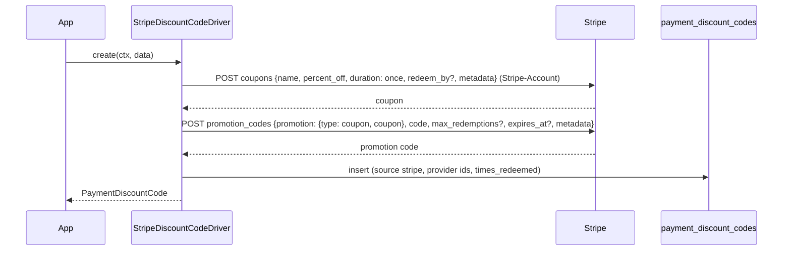

# Discount codes

[Home](Home.md) › Discount Codes

Percentage discount codes that a customer types. They run at Stripe (coupon + promotion code, mirrored locally) or only in the app.

## Contract

```php
interface ManagesDiscountCodes
{
    public function isHandledByCheckout(): bool;
    public function create(PaymentContext $context, CreateDiscountCodeData $data): PaymentDiscountCode;
    public function setActive(PaymentContext $context, PaymentDiscountCode $discountCode, bool $isActive, ?int $actorId = null): PaymentDiscountCode;
    public function validate(PaymentContext $context, string $code): DiscountValidationData;
    public function redeem(PaymentContext $context, PaymentDiscountCode $discountCode): PaymentDiscountCode;
    public function list(PaymentContext $context): Collection; // Collection<int, PaymentDiscountCode>
}
```

Picked by `$context->sources->discounts`.

| | `StripeDiscountCodeDriver` | `LocalDiscountCodeDriver` |
| --- | --- | --- |
| `isHandledByCheckout()` | `true`: Checkout applies the code | `false`: the app lowers the line items |
| Storage | Coupon + promotion code on the connected account, plus a mirror row in `payment_discount_codes` | Only a row in `payment_discount_codes` |
| `validate()`, `list()` | shared trait `ValidatesDiscountCodes` | shared trait `ValidatesDiscountCodes` |

Both drivers write to the same table; the `source` column says which driver owns a row.

## Types

`DiscountCodeType`:

| Case | Value | Meaning |
| --- | --- | --- |
| `ONE_TIME` | `one_time` | Works once, then counts as used. Stripe: `max_redemptions: 1`. |
| `LONG_TERM` | `long_term` | Anyone can use it between its start and end date, any number of times. |

Only percentage discounts exist (`percent_off`, unsigned tiny integer).

## Creating a code

```php
$code = Payments::discounts($context)->create($context, new CreateDiscountCodeData(
    type: DiscountCodeType::LONG_TERM,
    name: 'Spring offer',
    description: 'Ten percent off in April',
    code: 'spring-26',
    percentOff: 10,
    validFrom: CarbonImmutable::parse('2026-04-01'),
    validUntil: CarbonImmutable::parse('2026-04-30'),   // inclusive
    createdBy: $user->id,
    metadata: ['merchant_id' => '42'],                   // Stripe only
));
```

### CreateDiscountCodeData

| Property | Type | Notes |
| --- | --- | --- |
| `type` | `DiscountCodeType` | |
| `name` | `string` | Stripe coupon name is truncated to 40 characters. |
| `description` | `?string` | Stored locally only (Stripe has no field for it). |
| `code` | `string` | What the customer types. Stored upper-cased with `mb_strtoupper()`. |
| `percentOff` | `int` | 1 to 100 makes sense; the package does not validate it. |
| `validFrom` | `CarbonImmutable` | Stored locally only (Stripe has no start date). |
| `validUntil` | `?CarbonImmutable` | Inclusive; `null` = no end. Stripe: `redeem_by` and `expires_at` at the end of that day. |
| `createdBy` | `?int` | Id of the user who created it. |
| `metadata` | `array<string, string>` | Stripe coupon and promotion code metadata; not stored locally. |

The package does not validate input. The app should check at least: the code format, uniqueness in `payment_discount_codes.code` (the column is unique), percent range and `validUntil >= validFrom`.

### Stripe: what is created



- `duration: once` applies to one payment (relevant for subscriptions only; Checkout here is `mode: payment`).
- The local row stores `provider = stripe`, `provider_account_id`, `provider_discount_id` (promotion code id, `promo_...`) and `provider_coupon_id`.
- If the promotion code call fails after the coupon was created, the coupon stays at Stripe without a local row.

### Local: what is created

A row with `source = local` and no provider columns.

## Validating a code

```php
$result = Payments::discounts($context)->validate($context, $typedCode);
```

`ValidatesDiscountCodes::validate()`:

1. Finds the row with `whereCode($code)` (trims and upper-cases the input) **and** `source = $context->sources->discounts`. A code created under another source does not count.
2. No row: `DiscountValidationData::invalid('This code does not exist.')`.
3. Otherwise asks the row's computed `status` for a `reason()`. `null` reason: valid.

```php
class DiscountValidationData extends Data
{
    public bool $isValid;
    public ?string $reason;                       // message for the customer
    public ?PaymentDiscountCode $discountCode;    // also set when invalid but found
}
```

It does **not** check `provider_account_id`. A Stripe code created on an earlier connected account still validates, but its promotion code does not exist on the new account, so the checkout fails at Stripe.

### Statuses and reasons

`PaymentDiscountCode::$status` is a computed attribute (not a column), evaluated in this order:

| Order | Condition | `DiscountCodeStatus` | `reason()` |
| --- | --- | --- | --- |
| 1 | `deactivated_at` is set | `INACTIVE` | This code is no longer valid. |
| 2 | type `ONE_TIME` and `times_redeemed > 0` | `USED` | This code has already been used. |
| 3 | `valid_until` before today | `EXPIRED` | This code is no longer valid. |
| 4 | `valid_from` after today | `SCHEDULED` | This code is not valid yet. |
| 5 | otherwise | `ACTIVE` | `null` (valid) |

"Today" is `today()` in the app's timezone.

### valid_from handling

Stripe promotion codes have no start date, so `valid_from` exists only in the local row. Consequences for Stripe codes:

- When the customer types the code **in the app**, `validate()` rejects it before `valid_from` (`SCHEDULED`).
- When the app opens Checkout **without** a `providerDiscountId`, Checkout shows Stripe's own code field (`allow_promotion_codes`), and Stripe accepts a scheduled code there.

To enforce start dates strictly with Stripe codes, always validate in the app and pass the code to the checkout, or create the code only when it becomes valid.

## Applying a code at checkout

| Source | What the app does |
| --- | --- |
| `stripe` | Send full prices and `providerDiscountId: $code->provider_discount_id` in `CreateCheckoutData`. Stripe applies the coupon; `ProviderCheckoutData::$amountDiscount` reports the discount. |
| `local` | Lower the line amounts by `percent_off` before tax and checkout; send `providerDiscountId: null`. Stripe sees no code and reports no discount. |

## Redeeming

Call `redeem()` once the checkout is paid:

```php
$codeContext = $context->withDiscountSource($code->source);
Payments::discounts($codeContext)->redeem($codeContext, $code);
```

| Driver | `redeem()` |
| --- | --- |
| Stripe | Stripe already counted the redemption in Checkout. The driver retrieves the promotion code and copies `times_redeemed` into the row. |
| Local | `increment('times_redeemed')` on the row. |

Use the code's own `source` (via `withDiscountSource()`), not the merchant's current one, so a code created before a switch is redeemed by the right driver.

`validate()` and `redeem()` are separate steps. For a local `ONE_TIME` code, two customers can validate it at the same time and both pay; the package does not reserve codes. Stripe enforces `max_redemptions` itself for Stripe codes.

## Activating and deactivating

```php
$codeContext = $context->withDiscountSource($code->source);
Payments::discounts($codeContext)->setActive($codeContext, $code, isActive: false, actorId: $user->id);
```

| Driver | Effect |
| --- | --- |
| Stripe | Updates the promotion code's `active` at Stripe (on `provider_account_id`, falling back to the context's account), copies `times_redeemed`, sets or clears `deactivated_at` / `deactivated_by`. |
| Local | Sets or clears `deactivated_at` / `deactivated_by`. |

The discount and its usage history are kept. Nothing deletes codes.

Other fields (`name`, `description`) can be updated directly on the model; for Stripe codes that does not update the coupon name at Stripe.

## Listing

`list()` returns **all** rows of `payment_discount_codes` on the tenant connection, newest first, regardless of source or account. Filter in the app if needed.

## Security

- `validate()` is an oracle for which codes exist. The package does not rate limit it; throttle the endpoint that calls it.
- Codes must have enough entropy if they are meant to be private. Short or guessable codes can be brute-forced through any public quote or checkout endpoint.
- Codes are compared case-insensitively (stored upper case).
