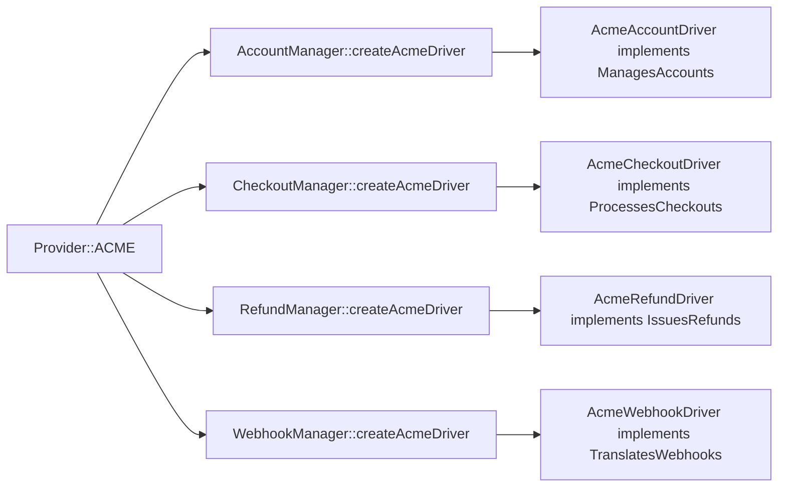

# Extending

[Home](Home.md) › Extending

Every capability is an `Illuminate\Support\Manager`. A new driver is a class that implements the capability's contract, registered on the manager with `extend()` or added to the package as a `create{Name}Driver()` method.

## Rules for drivers

- **Stateless.** A driver instance is cached by its manager and reused for every merchant in the process. Take everything merchant-specific from the `PaymentContext` argument. Constructor arguments may only hold process-wide things (clients, config).
- **Account calls through `requireAccount()`.** It throws `AccountNotConnectedException` when no account is connected.
- **Report checkout handling honestly.** Invoice, tax and discount drivers return `true` from `isHandledByCheckout()` only when the provider's checkout does the work. Methods that make no sense then should throw `HandledByCheckoutException`.
- **Return the package's DTOs** (`ProviderCheckoutData`, `InvoiceData`, ...), with amounts in minor units including tax.
- **Do not catch provider exceptions** unless you can handle them; the host app decides how to present them.

## Driver names

The facade asks a manager for a driver by a string:

| Capability | Name passed to `driver()` |
| --- | --- |
| Accounts, checkouts, refunds | `$context->provider->value` |
| Invoices, tax, discounts | `$context->sources->{capability}->value` |
| Webhooks | `$provider->value` |

So a new **provider** needs a new `Provider` case, and a new **source** needs a new `CapabilitySource` case. Both enums are part of the package; adding a case means changing the package (enums cannot be extended from the app). `extend()` alone works when you replace an existing name, for example a custom `local` tax driver.

## Replacing a driver from the app

The service provider binds the seven managers as container singletons, and `Payments` receives those same instances. Extend the manager from your service provider's `boot()`:

```php
use NetOS\Payments\Managers\TaxManager;

public function boot(): void
{
    $this->app->make(TaxManager::class)->extend('local', fn ($app) => new MyTaxDriver(
        country: config('payments.local.tax_country'),
    ));
}
```

A manager caches a driver once it is created, and `extend()` does not clear that cache. Register the driver before the name is first used, for example in `boot()`.

## Example: a local tax driver with per-line categories from config

```php
use NetOS\Payments\Contracts\CalculatesTax;
use NetOS\Payments\Data\TaxableLineData;
use NetOS\Payments\Data\TaxedLineData;
use NetOS\Payments\PaymentContext;
use RuntimeException;

class ConfigTaxDriver implements CalculatesTax
{
    /** @param array<string, float> $rates category => percentage */
    public function __construct(private readonly array $rates) {}

    public function isHandledByCheckout(): bool
    {
        return false;
    }

    public function calculate(PaymentContext $context, array $lines): array
    {
        return array_map(function (TaxableLineData $line): TaxedLineData {
            $rate = $this->rates[$line->category] ?? throw new RuntimeException("No rate for {$line->category}.");

            return new TaxedLineData(
                description: $line->description,
                amount: $line->amount,
                taxPercentage: $rate,
                taxAmount: $line->amount - (int) round($line->amount * 100 / (100 + $rate)),
            );
        }, $lines);
    }
}
```

## Adding a provider (PSP)

To add, say, a provider `acme`:

1. **Enum:** add `case ACME = 'acme';` to `NetOS\Payments\Enums\Provider`.
2. **Drivers:** implement the provider-bound contracts:

   | Contract | Required for |
   | --- | --- |
   | `ManagesAccounts` | onboarding merchants |
   | `ProcessesCheckouts` | taking payments |
   | `IssuesRefunds` | refunds |
   | `TranslatesWebhooks` | the webhook route `/payments/webhooks/acme` |

3. **Managers:** add `createAcmeDriver()` to `AccountManager`, `CheckoutManager`, `RefundManager` and `WebhookManager`, or `extend('acme', ...)` them.
4. **Sources:** the `stripe` source drivers (Stripe invoices, Stripe Tax, Stripe promotion codes) only work with Stripe. For a provider that also invoices or calculates tax, add a `CapabilitySource` case and source drivers. Otherwise merchants on that provider must use `local` sources, and `StripeCheckoutDriver`'s source handling has to be mirrored in the new checkout driver.
5. **Webhooks:** `translate()` must verify the signature and throw `UnexpectedValueException` (or Stripe's `SignatureVerificationException`) for bad requests, including a body that cannot be decoded, because only those map to `400` in `WebhookController`. `checkoutId()` and `isAccountEvent()` decide what `ProcessWebhookEventJob` does.
6. **Config:** add a provider section to `config/payments.php` and read it in the `create...Driver()` methods.
7. **Account context:** `PaymentContext::forAccount()` uses Stripe-managed sources; it is only meant for account calls and works for any provider.



## Adding a local driver for a payment capability

Accounts, checkouts and refunds are picked by provider, not by source, so a "local" checkout (for example manual bank transfer) would be a new `Provider` case with its own drivers, not a `local` source.

## Adding a source driver

For invoices, tax and discounts, add `create{Source}Driver()` to the manager (or `extend()`), named after the `CapabilitySource` value. If the new source can run inside the provider's checkout, `StripeCheckoutDriver::create()` must learn what to add to the session for it, and `CapabilitySourcesData::problem()` must be updated if the validity rule changes.

## Invoice drivers

`ProvidesInvoices` changed with credit notes as documents:

```php
public function creditNote(
    PaymentContext $context,
    string $invoiceReference,
    int $amount,
    ?string $providerRefundId = null,
): InvoiceData;
```

- **Return the credit note**, not the invoice: `InvoiceData` with `type = 'credit_note'` and `creditsReference` = the credited invoice's reference.
- **Cap the amount** at what is left to credit; the local driver throws `InvalidArgumentException` for `$amount <= 0` or more than `total - credited_amount`.
- **Link, do not refund.** When `$providerRefundId` is given, attach the credit note to that existing refund (Stripe: `refunds: [{refund, amount_refunded}]`) so the provider does not refund a second time. A driver without provider refunds may ignore it, as the local driver does.
- **Report the shared statuses** for a credited invoice: `partially_credited` while credits are below the total, `credited` once they reach it.
- **Fill `InvoiceData::$type`** (`invoice` or `credit_note`, default `invoice`) and `$creditsReference` from `find()` too.
- **Dispatch `PaymentInvoiceIssued`** for every document the host app has to deliver itself (a document the provider does not email), with the payer email and, when the PDF is stored locally, its disk and path.
- **Accept `IssueInvoiceData::$customer`** (`?CustomerDetailsData`) and print it on the document.
- **Sign links with `PaymentContext::$urlParameters`** when the driver serves documents from the host app; `LocalDocumentPresenter` does this for `PaymentInvoice` rows.

## Discount drivers

Reuse `NetOS\Payments\Drivers\Concerns\ValidatesDiscountCodes` for `validate()` and `list()`: it reads `payment_discount_codes` filtered by the context's discount source, and for the `stripe` source both `validate()` and `list()` also filter by `provider_account_id`. Write rows with the right `source` value so they are found.

`ManagesDiscountCodes` has two methods for holding a one-time code during an open checkout, and `validate()` takes the checkout's reference:

```php
public function validate(PaymentContext $context, string $code, ?string $reference = null): DiscountValidationData;
public function reserve(PaymentContext $context, PaymentDiscountCode $discountCode, string $reference, CarbonInterface $until): bool;
public function release(PaymentContext $context, PaymentDiscountCode $discountCode, string $reference): void;
```

- `reserve()` returns `false` only when another checkout holds the code. A driver whose provider enforces single use itself can make both methods no-ops (`StripeDiscountCodeDriver` returns `true` and holds nothing).
- A driver that holds codes in `reserved_reference` / `reserved_until` must claim them atomically (the local driver uses one conditional `UPDATE`), and `redeem()` must clear the hold.
- `ValidatesDiscountCodes::validate()` reports `DiscountCodeStatus::RESERVED` ("This code is already in use.") unless the hold has the given `$reference`.

## Testing drivers

The package's own suite is described in [Testing](Testing.md). Practical options for a new driver:

- Reuse the suite's `FakeStripe` approach: register a recording fake with `Stripe\ApiRequestor::setHttpClient()` so the real Stripe client talks to it.
- Bind your own `Stripe\StripeClient` in the container (for example pointed at `stripe-mock`) before the managers create drivers.
- Construct drivers directly with fakes; all their dependencies are constructor arguments.
- Build contexts with `new PaymentContext(Provider::STRIPE, 'acct_test', PaymentProfile::LOCALLY_MANAGED->sources(), new IssuerData('Test'))`.
