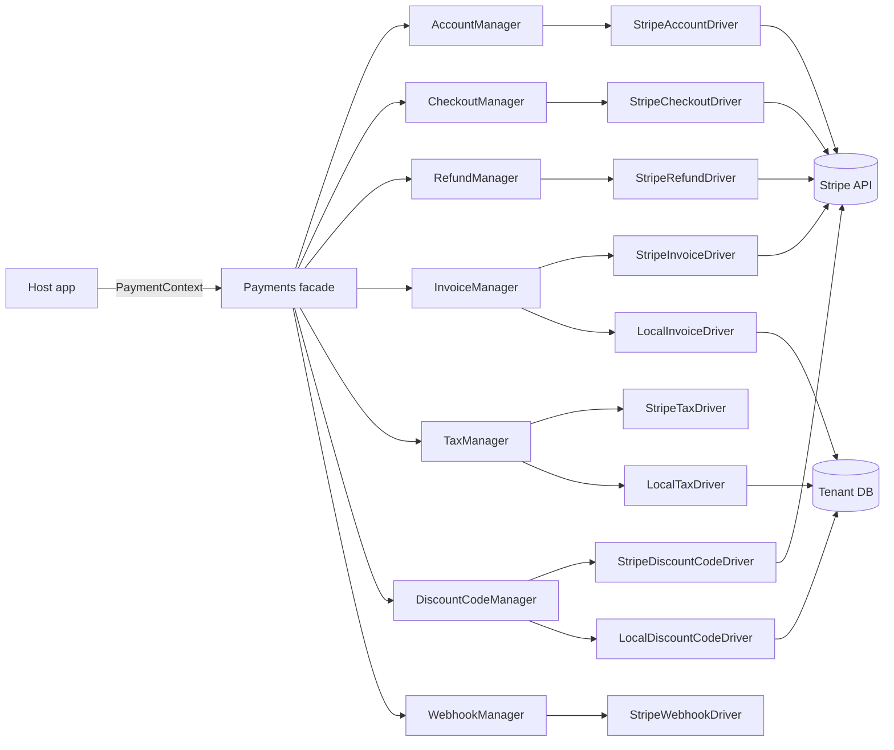

# Laravel Payments wiki

`net-os/laravel-payments` is a PSP-agnostic layer for payments, invoices, tax and discount codes in multi-tenant Laravel apps. Stripe Connect is the first provider. Net OS is the reference host app.

> [!WARNING]
> Proof of concept. Not every capability has both drivers, the tests run against a fake of Stripe's API only, and the API, config and schema may change. Read [Security and Limitations](Security-and-Limitations.md) before using it.

## Pages

| Page | What it covers |
| --- | --- |
| [Architecture](Architecture.md) | Layers, the `Payments` entry point, one manager per capability, how a driver is picked, diagrams. |
| [Configuration](Configuration.md) | Every config key, env var and default; connections; the service provider; migrations. |
| [Payment Context](Payment-Context.md) | `PaymentContext`, `CapabilitySourcesData` and its validation rule, `PaymentProfile` presets. |
| [Accounts and Onboarding](Accounts-and-Onboarding.md) | Stripe Connect Accounts v2, account links, refresh and return, defaults and branding, account status and sync. |
| [Checkout](Checkout.md) | `CreateCheckoutData`, line items, tax and discounts per source, invoices in Checkout, expiry, statuses. |
| [Tax](Tax.md) | Stripe Tax vs the local rate table, inclusive tax rates on Stripe. |
| [Discount Codes](Discount-Codes.md) | Promotion codes and coupons vs local codes, validation, statuses, reservations, redemption. |
| [Invoices](Invoices.md) | Stripe invoices created in Checkout vs local invoices, numbering, credit notes, PDF and signed links, delivery. |
| [Refunds](Refunds.md) | Refunding a direct charge, credits on local invoices. |
| [Webhooks](Webhooks.md) | Route, signature verification, storage, job, events, Stripe event destinations, Stripe CLI. |
| [Data Model](Data-Model.md) | Every table and column, central vs tenant, models and casts. |
| [Extending](Extending.md) | Writing a driver or a new provider and registering it. |
| [Host App Integration](Host-App-Integration.md) | What the app must build, with Net OS as worked example. |
| [Security and Limitations](Security-and-Limitations.md) | Security notes and known limitations, with file references. |
| [Testing](Testing.md) | The Pest suite, the fake Stripe API, running the tests and CI. |
| [Glossary](Glossary.md) | Terms used in the code and these pages. |

## In one picture

## Where to start

1. Install and configure: [Configuration](Configuration.md).
2. Implement `ResolvesPaymentContext` and `ProvidesIssuer`: [Host App Integration](Host-App-Integration.md).
3. Connect an account: [Accounts and Onboarding](Accounts-and-Onboarding.md).
4. Take a payment: [Checkout](Checkout.md), then [Webhooks](Webhooks.md).
