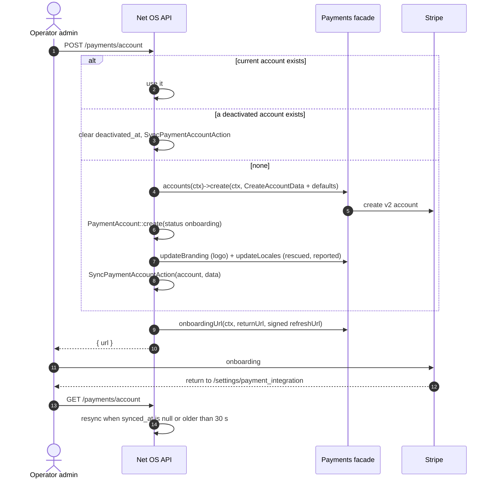

# Host app integration

[Home](Home.md) › Host App Integration

The package gives drivers, tables and a webhook pipeline. Everything about *what* is being paid for, *who* the merchant is and *which* sources a merchant chose belongs to the host app. This page lists what the app must build, with the Net OS pay-as-you-go spike as worked example (Laravel 12, stancl/tenancy with a database per tenant, tenants are workspace operators, guests book and pay for desks).

## Checklist

| # | What | Required | Net OS example |
| --- | --- | --- | --- |
| 1 | Install, config, central + tenant migrations | yes | `config/payments.php` (published), tenant path in `config/tenancy.php` |
| 2 | Queue worker for `payments.queue` | yes | `payments` case in the app's queue enum, run by Horizon |
| 3 | `ResolvesPaymentContext` binding | yes | `App\Services\Payments\TenantPaymentContextResolver` |
| 4 | `ProvidesIssuer` binding | for local invoicing | `App\Services\Payments\TenantIssuerProvider` |
| 5 | Storage of the merchant's sources + settings screen | yes, unless fixed | `tenants.payment_settings` (tenant data), `GetPaymentSourcesAction`, `UpdatePaymentSourcesAction` |
| 6 | Connect / disconnect / onboarding refresh flow | yes | `ConnectPaymentAccountAction`, `DisconnectPaymentAccountAction`, `CreatePaymentOnboardingUrlAction`, signed refresh route |
| 7 | The app's own payment record | yes | `payments` + `payment_line_items` tenant tables |
| 8 | Checkout creation | yes | `CreateGuestBookingAction` |
| 9 | Idempotent checkout sync (webhook + return page) | yes | `SyncGuestPaymentAction` |
| 10 | Listener for `PaymentCheckoutUpdated` | yes | `SyncGuestPaymentOnCheckoutUpdated` |
| 11 | Invoices per source | yes | `IssueLocalInvoiceAction`, `SyncPaymentInvoiceAction` |
| 11a | Document routes in the right context, PDF renderer and disk | for local invoicing | `routes.documents_middleware`, `PaymentContext::$urlParameters`, `local.invoice_disk` |
| 11b | Listener for `PaymentInvoiceIssued` that mails the document | for local invoicing and credit notes | |
| 12 | Refunds | optional | `RefundPaymentAction` |
| 13 | Discount code admin + validation | optional | `CreateDiscountCodeAction`, `SetDiscountCodeActiveAction`, `DiscountCodeController` |
| 14 | Local tax rates | for local tax | a tenant migration inserting `NL / workspace_rental / 21` |
| 15 | Rate limiting of public endpoints | yes | `throttle:60,1` on the guest routes |
| 16 | Stripe event destinations and secrets | yes | `.env` keys `STRIPE_SECRET`, `STRIPE_WEBHOOK_SECRET`, `STRIPE_THIN_WEBHOOK_SECRET` |

## 1. Configuration

Net OS publishes the config and sets:

```php
'connections' => [
    'central' => env('DB_CONNECTION', 'mysql'),
    // Null: the tenant connection that tenancy sets as default.
    'tenant' => null,
],
```

and adds app-only keys that the package ignores but the app reads:

```php
'account_defaults' => [
    'locales' => ['nl-NL'],
    'support_url' => env('PAYMENTS_SUPPORT_URL'),
    // Printed at the bottom of every Stripe invoice; :operator is replaced by the operator's name.
    'invoice_footer' => 'Workspace booked through Net OS at :operator.',
],
```

For local documents it sets the document routes' middleware and the PDF disk:

```php
// Signed links of local invoices and credit notes; the tenant comes from the ?tenant parameter of the link.
'routes' => [
    'documents_prefix' => 'payments/documents',
    'documents_middleware' => [InitializeTenancyByRequestData::class],
],

'local' => [
    'invoice_number_prefix' => env('PAYMENTS_INVOICE_PREFIX', 'INV'),
    'credit_note_number_prefix' => env('PAYMENTS_CREDIT_NOTE_PREFIX', 'CN'),
    'tax_country' => env('PAYMENTS_TAX_COUNTRY', 'nl'),
    // The tenant-suffixed bucket, so web and queue pods reach the same PDFs.
    'invoice_disk' => env('PAYMENTS_INVOICE_DISK', 'gcs'),
],
```

The PDF renderer is configured through spatie/laravel-pdf's own settings (`LARAVEL_PDF_DRIVER` and the driver's credentials); see [Configuration](Configuration.md#pdf-rendering).

Tenant migrations are registered in `config/tenancy.php`:

```php
'--path' => [database_path('migrations/tenant'), base_path('vendor/net-os/laravel-payments/database/migrations/tenant')],
```

## 2. Bindings

```php
// AppServiceProvider::register()
$this->app->bind(ResolvesPaymentContext::class, TenantPaymentContextResolver::class);
$this->app->bind(ProvidesIssuer::class, TenantIssuerProvider::class);
```

### TenantPaymentContextResolver

```php
class TenantPaymentContextResolver implements ResolvesPaymentContext
{
    public function __construct(private readonly ProvidesIssuer $issuer) {}

    public function current(): PaymentContext
    {
        $tenant = tenant();
        $account = PaymentAccount::query()->forOwner($tenant)->current()->first();

        return new PaymentContext(
            provider: $account->provider ?? Provider::STRIPE,
            providerAccountId: $account?->provider_account_id,
            sources: GetPaymentSourcesAction::make()->handle($tenant)->assertAllowed(),
            issuer: $this->issuer->issuer(),
            // Signed document links carry the tenant, which the tenancy middleware reads from ?tenant.
            urlParameters: ['tenant' => (string) $tenant->getTenantKey()],
        );
    }
}
```

- The owner of a `PaymentAccount` is the tenant model (`forOwner($tenant)`).
- `urlParameters` end up in the signed `hostedUrl` and `pdfUrl` of local documents, so the document routes can initialize tenancy (`InitializeTenancyByRequestData` in `payments.routes.documents_middleware`). Because `RenderInvoicePdfJob` and the presenter take them from the context, every context that issues, finds or credits a local document must carry them.
- Before an account is connected, `providerAccountId` is `null`; code paths that need an account get `AccountNotConnectedException` from the drivers, which the app turns into validation messages.
- The sources are checked with `assertAllowed()` every time a context is built.

### TenantIssuerProvider

```php
class TenantIssuerProvider implements ProvidesIssuer
{
    public function issuer(): IssuerData
    {
        return new IssuerData(name: (string) tenant()->name);
    }
}
```

In the spike only the operator's name is known; address, Chamber of Commerce number and VAT number are left `null`. A production implementation must fill them for legally valid invoices.

### Context for an existing payment

A payment must be handled on the account and invoicing source it was made with, even if the tenant changed them since:

```php
class ResolvePaymentContextAction
{
    public function handle(Payment $payment): PaymentContext
    {
        $context = $this->contexts->current()->withAccount($payment->provider_account_id);

        return $payment->invoice_source === null
            ? $context
            : $context->withInvoicingSource(CapabilitySource::from($payment->invoice_source));
    }
}
```

## 3. Sources per tenant

Net OS stores the choice in the tenant's data column `payment_settings` (`{invoicing, tax, discounts}`):

```php
class GetPaymentSourcesAction
{
    public function handle(Tenant $tenant): CapabilitySourcesData
    {
        $settings = $tenant->payment_settings ?? [];

        return new CapabilitySourcesData(
            invoicing: CapabilitySource::tryFrom($settings['invoicing'] ?? '') ?? CapabilitySource::STRIPE,
            tax: CapabilitySource::tryFrom($settings['tax'] ?? '') ?? CapabilitySource::LOCAL,
            discounts: CapabilitySource::tryFrom($settings['discounts'] ?? '') ?? CapabilitySource::STRIPE,
        );
    }
}
```

The default (Stripe invoices, local VAT, Stripe codes) is valid but is not one of the `PaymentProfile` presets. `UpdatePaymentSourcesAction` turns `CapabilitySourcesData::problem()` into a `ValidationException` on `invoicing`. A change applies to new bookings and codes; existing codes keep their `source`, existing payments keep their `invoice_source`.

API: `GET /payments/settings`, `PUT /payments/settings`.

## 4. Connecting the operator's Stripe account



Details from the reference implementation:

- **Defaults** (`BuildPaymentAccountDefaultsAction`): statement descriptor derived from the operator's name (ASCII, upper case, `A-Z0-9` and spaces, 5 to 22 characters, padded with ` DESKS` when too short), the connecting admin's email as support email, the support URL and locales from config, brand colors from the tenant's theme (only valid `#RRGGBB`), and the tenant's logo copied to a temporary file when it is PNG or JPEG.
- **Logo after create** (`ApplyPaymentAccountDefaultsAction`): calls `updateBranding()` and `updateLocales()`, then deletes the temporary logo file. Wrapped in `rescue(..., report: true)` on connect, so a logo Stripe refuses does not block connecting.
- **Refresh URL**: `URL::temporarySignedRoute('payments.account.onboarding.refresh', now()->addDay(), ['tenant' => $ownerId])`. The route is behind the `signed` middleware; its controller mints a new link and redirects to it.
- **Disconnect** (`DELETE /payments/account`): sets `status = deactivated` and `deactivated_at`. The Stripe account stays with the operator and is reused on reconnect.
- **Configuration check** (`GET /payments/account/configuration`): `CheckPaymentAccountConfigurationAction` compares `configuration()` with the defaults (colors, logo, locales, descriptor, support email and phone) and reports each as OK, missing, different or manual, with whether the app can fix it. `PUT /payments/account/configuration` re-applies what stays writable (branding and locales).

## 5. The app's payment record

The package does not store checkouts. Net OS has a tenant `payments` table with, among others:

| Column | Filled from |
| --- | --- |
| `uuid` | app; used in URLs and as invoice `reference` |
| `status` | app enum: pending, paid, expired, refunded |
| `discount_code_id` | `payment_discount_codes.id` (no FK) |
| `subtotal`, `discount_amount`, `total`, `vat_amount`, `currency` | quote, then overwritten by `ProviderCheckoutData` when paid |
| `invoice_source` | `$context->sources->invoicing->value` at booking time |
| `provider`, `provider_account_id` | the context at booking time |
| `provider_checkout_id`, `checkout_url` | `ProviderCheckoutData` |
| `provider_payment_id`, `provider_invoice_id` | `ProviderCheckoutData` when paid; for local invoices `InvoiceData::$reference` |
| `invoice_number`, `invoice_status`, `invoice_url`, `invoice_pdf_url` | `InvoiceData` |
| `provider_refund_id`, `refunded_amount`, `refunded_at`, `refunded_by` | `ProviderRefundData` |
| `expires_at`, `paid_at` | app |

## 6. Pricing, discounts and tax before the checkout

`PriceLineItemsAction` is the single place that turns gross line amounts into what is charged and invoiced:

1. Spreads `percent_off` over the lines (rounding difference on the last line).
2. When tax is local (`! Payments::tax($ctx)->isHandledByCheckout()`), calls `calculate()` with the discounted amounts and category `workspace_rental`.
3. Returns per line: gross amount, discount, net amount, tax percentage, tax amount.

The quote endpoint, the checkout and the local invoice all use it, so they always agree.

Discount validation in the quote: `Payments::discounts($ctx)->validate($ctx, $code)`; an invalid code returns its `reason` to the guest. Public guest endpoints are throttled with `throttle:60,1`.

To keep a local one-time code from being used by two open checkouts, the package offers `reserve()` (when the checkout is created, until it expires), `release()` (when it expires or is cancelled) and `validate($ctx, $code, $reference)` that ignores the checkout's own hold; `redeem()` ends the hold. See [Discount Codes](Discount-Codes.md#reserving).

## 7. Creating the checkout

`CreateGuestBookingAction` (abridged):

```php
$context = app(ResolvesPaymentContext::class)->current();

if ($context->providerAccountId === null) {
    throw ValidationException::withMessages(['resourceId' => 'Guests cannot pay at this location yet.']);
}

// ... in a transaction: lock the desk, quote, create guest, hold the desk, create the Payment with
// 'invoice_source' => $context->sources->invoicing->value, 'provider_account_id' => $context->providerAccountId,
// 'expires_at' => now()->addMinutes(31)

$isDiscountAtCheckout = Payments::discounts($context)->isHandledByCheckout();
$priced = PriceLineItemsAction::make()->handle($context, $lines, $payment->discountCode->percent_off ?? 0);

try {
    $checkout = Payments::checkouts($context)->create($context, new CreateCheckoutData(
        lineItems: array_map(fn (PricedLineData $line) => new CheckoutLineItemData(
            description: $line->description,
            unitAmount: $isDiscountAtCheckout ? $line->grossAmount : $line->amount,
            taxPercentage: $line->taxPercentage,
        ), $priced->lines),
        currency: $payment->currency,
        customerEmail: $payment->guest->email,
        successUrl: $paymentUrl,
        cancelUrl: $paymentUrl . '&cancelled=1',
        expiresAt: $payment->expires_at,
        providerDiscountId: $isDiscountAtCheckout ? $payment->discountCode?->provider_discount_id : null,
        description: $this->describe($payment),
        invoiceFooter: str_replace(':operator', $tenant->name, config('payments.account_defaults.invoice_footer')),
        metadata: ['tenant_id' => $tenant->getTenantKey(), 'payment_uuid' => $payment->uuid],
    ));
} catch (ApiErrorException $exception) {
    ReleaseGuestBookingAction::make()->handle($payment, PaymentStatusEnum::EXPIRED);
    throw ValidationException::withMessages(['from' => 'The payment could not be started: ' . $exception->getMessage()]);
}

$payment->update(['provider_checkout_id' => $checkout->providerCheckoutId, 'checkout_url' => $checkout->url]);
```

The desk is held before payment so nobody else can take it, and released when the checkout expires or is cancelled.

## 8. Syncing a checkout (webhook and return page)

`SyncGuestPaymentAction` runs from the webhook listener and from `GET /guest/payments/{uuid}` (the success page), whichever comes first:

1. Skip unless the payment is `pending` and has a `provider_checkout_id`.
2. `fetch()` the checkout with `ResolvePaymentContextAction`'s context.
3. If still `OPEN` but past `expires_at`, `expire()` it (covers a lost `expired` webhook).
4. `EXPIRED`: release the desk.
5. `PAID`: in a transaction, `lockForUpdate()` the payment, re-check `pending`, store amounts and provider ids, and `redeem()` the discount code with `$context->withDiscountSource($code->source)`.
6. Then invoice: local invoicing without an invoice yet → `IssueLocalInvoiceAction`; otherwise `SyncPaymentInvoiceAction` (reads the Stripe invoice; re-runs until it has a number and PDF).

`DELETE /guest/payments/{uuid}` (the cancel page) syncs first, then expires an open checkout and releases the desk, or keeps the payment if it turned out to be paid.

## 9. Webhook listener

```php
class SyncGuestPaymentOnCheckoutUpdated
{
    public function handle(PaymentCheckoutUpdated $event): void
    {
        $account = PaymentAccount::query()
            ->where('provider', $event->provider)
            ->where('provider_account_id', $event->providerAccountId)
            ->first();

        if (! $account?->owner instanceof Tenant) {
            return;
        }

        $account->owner->run(function () use ($event): void {
            $payment = Payment::query()->where('provider_checkout_id', $event->providerCheckoutId)->first();

            if ($payment !== null) {
                SyncGuestPaymentAction::make()->handle($payment);
            }
        });
    }
}
```

Registered through Laravel's listener discovery (`withEvents(discover: [app/Listeners/*])`). Net OS has no listener for `PaymentAccountUpdated`.

## 10. Invoices

- **Local** (`IssueLocalInvoiceAction`): re-prices the stored line items with `PriceLineItemsAction`, maps them to `TaxedLineData`, calls `issue()` with `reference = payment uuid`, and stores `InvoiceData::$reference` in `provider_invoice_id` plus number and status.
- **Stripe** (`SyncPaymentInvoiceAction`): calls `find()` with the Stripe invoice id until `invoice_number` and `invoice_pdf_url` are set (or always, with `force`).

What the package expects from any host app:

- Pass the checkout's billing details into the local invoice: `IssueInvoiceData::$customer` = `ProviderCheckoutData::$customer`. Stripe Checkout always collects them (billing address and tax id), whatever the invoicing source.
- Re-read a local invoice with `find()` after `PaymentInvoiceIssued` (or later) to get its `pdfUrl`; `issue()` returns it as `null` because the PDF is rendered on the queue.
- Listen to `PaymentInvoiceIssued` and mail the document to `$event->payerEmail`: local invoices and credit notes (PDF on `$event->pdfDisk` / `$event->pdfPath`) and Stripe credit notes (`$event->document->pdfUrl` only). The package sends no mail; Stripe still emails its own invoices. See [Invoices](Invoices.md#delivery).

## 11. Refunds

`RefundPaymentAction` (`POST /payments/refunds`):

1. Only `paid` payments with a `provider_payment_id`.
2. `refund()` the whole payment with `ResolvePaymentContextAction`'s context; Stripe errors become validation errors.
3. Store refund id, amount, time and user; status `refunded`.
4. Release the desk when the booking has not ended.
5. When the payment has an invoice (`provider_invoice_id`), for both sources: `creditNote()` with the invoice's source (`withInvoicingSource()`), the refunded amount and `$refund->providerRefundId`, so a Stripe credit note is linked to the refund instead of refunding again. The payer receives the credit note by mail through `PaymentInvoiceIssued`; the payment keeps pointing at the invoice itself.
6. Re-sync the invoice fields (`force: true`); the invoice status becomes `partially_credited` or `credited` for both sources.

## 12. Discount codes

- `GET /payments/discount-codes` → `Payments::discounts($ctx)->list($ctx)` (the codes of the context's discount source, and for Stripe of the current account).
- `POST /payments/discount-codes` → `CreateDiscountCodeAction`: validates code format (`[A-Za-z0-9-]`, max 30), uniqueness in `payment_discount_codes.code`, percentage 1–100, `validFrom >= today`, `validUntil >= validFrom`; creates in the tenant's current discount source; `AccountNotConnectedException` and Stripe errors become validation errors; passes `metadata: ['tenant_id' => ...]`.
- `PUT /payments/discount-codes/{id}` → `UpdateDiscountCodeAction`: toggles active through `setActive()` with the code's own source, then updates name and description locally.

## 13. Tax rates

A tenant migration inserts the Dutch rate for every tenant:

```php
DB::table('payment_tax_rates')->insert([
    'country' => 'NL', 'category' => 'workspace_rental', 'rate' => 21,
    'valid_from' => null, 'valid_until' => null, 'created_at' => now(), 'updated_at' => now(),
]);
```

## 14. Authorization

All admin endpoints sit behind the app's authentication and a pay-as-you-go permission check (`AuthorizesPayAsYouGo`). The package itself has no authorization: anyone who can call the facade can move money on the context's account. Guest endpoints identify the payment by an unguessable UUID.
