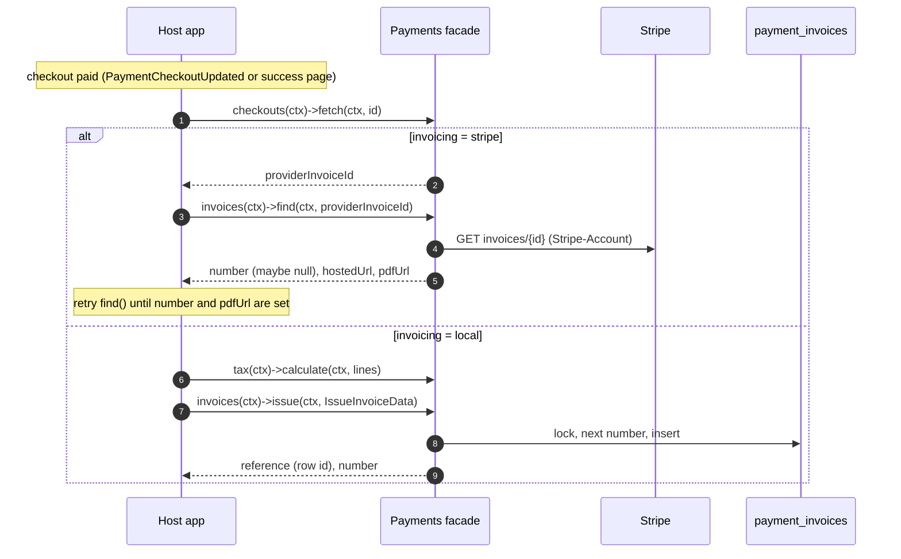

# Invoices

[Home](Home.md) › Invoices

## Contract

```php
interface ProvidesInvoices
{
    /** True when the provider creates the invoice inside its checkout; the app then only reads it. */
    public function isHandledByCheckout(): bool;
    public function issue(PaymentContext $context, IssueInvoiceData $data): InvoiceData;
    public function find(PaymentContext $context, string $invoiceReference): InvoiceData;
    /** Credits (part of) an invoice, e.g. after a refund. */
    public function creditNote(PaymentContext $context, string $invoiceReference, int $amount): InvoiceData;
}
```

Picked by `$context->sources->invoicing`.

| Method | `StripeInvoiceDriver` | `LocalInvoiceDriver` |
| --- | --- | --- |
| `isHandledByCheckout()` | `true` | `false` |
| `issue()` | throws `HandledByCheckoutException('Invoicing')` | creates a numbered row in `payment_invoices` |
| `find()` | retrieves the Stripe invoice | reads the row by id |
| `creditNote()` | throws `LogicException('Stripe credit notes are not part of the POC.')` | adds to `credited_amount`, sets status `credited` |

### InvoiceData

| Property | Type | Stripe | Local |
| --- | --- | --- | --- |
| `source` | `CapabilitySource` | `stripe` | `local` |
| `reference` | `string` | invoice id (`in_...`) | the row id, as string |
| `number` | `?string` | Stripe's number; `null` until finalized | e.g. `INV-2026-0001` |
| `status` | `string` | Stripe's status (`draft`, `open`, `paid`, ...) | `issued` or `credited` |
| `hostedUrl` | `?string` | `hosted_invoice_url` | `null` |
| `pdfUrl` | `?string` | `invoice_pdf` | `null` |

`reference` is what the app stores and passes back to `find()` and `creditNote()`.

## Stripe invoices

With `invoicing = stripe`, `StripeCheckoutDriver` turns on `invoice_creation`. Stripe creates, numbers, renders and emails the invoice as part of the paid Checkout Session, on the connected account, with:

- `description` and `footer` (`CreateCheckoutData::$invoiceFooter`), `metadata`;
- `rendering_options.amount_tax_display: include_inclusive_tax`;
- a Stripe customer (`customer_creation: always`) and tax id collection.

After payment, `ProviderCheckoutData::$providerInvoiceId` holds the invoice id. Stripe finalizes the invoice shortly after the payment, so `number` and `pdfUrl` can be `null` on the first `find()`. Call `find()` again later (the reference host app re-syncs until the number and PDF link are present).

The account holder's Stripe email settings decide whether Stripe emails the invoice; the API does not expose that setting.

Credit notes for Stripe invoices are not implemented. A Stripe refund leaves the invoice as it is (Stripe shows the refund on the charge).

## Local invoices

> [!NOTE]
> Skeleton for the POC: there is no PDF, no email and no hosted page, and a credit is recorded on the invoice instead of as a separate credit note document.

### Issuing

```php
$lines = Payments::tax($context)->calculate($context, [
    new TaxableLineData('Desk 4.12, 09:00 - 12:00', 2160, 'workspace_rental'),
]);

$invoice = Payments::invoices($context)->issue($context, new IssueInvoiceData(
    payerName: 'Guest Name',
    payerEmail: 'guest@example.com',
    lines: $lines,              // TaxedLineData[], after any discount
    discountAmount: 240,        // informational
    currency: 'eur',
    reference: $payment->uuid,  // what the invoice is for in the app
));
```

`LocalInvoiceDriver::issue()`:

1. Throws `RuntimeException('Local invoices need an issuer.')` when `$context->issuer` is `null`.
2. Opens a transaction on `payments.connections.tenant`.
3. Builds the prefix `{payments.local.invoice_number_prefix}-{current year}-`.
4. Reads `max(number)` of rows with that prefix with `lockForUpdate()` and adds 1 (or starts at 1).
5. Creates the row:

| Column | Value |
| --- | --- |
| `number` | prefix + sequence padded to 4 digits, e.g. `INV-2026-0001` |
| `status` | `issued` |
| `reference` | `IssueInvoiceData::$reference` |
| `issuer` | `$context->issuer->toArray()` (snapshot: name, address, chamberOfCommerceNumber, vatNumber) |
| `payer_name`, `payer_email` | from the data |
| `lines` | each `TaxedLineData::toArray()` |
| `discount_amount` | from the data |
| `tax_amount` | sum of line `taxAmount` |
| `total` | sum of line `amount` (lines are already after discount) |
| `currency` | from the data |
| `issued_at` | `now()` |

6. Returns `InvoiceData` with `reference` = the row id.

Numbering is gap-free and per calendar year as long as every invoice goes through `issue()`. The `number` column is unique, so a concurrent duplicate fails instead of being written twice.

### Finding

`find($context, $reference)` loads the row with `findOrFail($reference)`.

### Crediting

```php
Payments::invoices($context)->creditNote($context, $invoice->reference, 2160);
```

Adds `$amount` to `credited_amount`, sets `status = credited` and `credited_at = now()`. The invoice is otherwise immutable; a refund adds a credit, never an edit. There is no separate credit note number, and no check that the credited total stays within `total`. A partial credit also sets `status` to `credited`.

### IssuerData

```php
class IssuerData extends Data
{
    public function __construct(
        public string $name,
        public ?string $address = null,
        public ?string $chamberOfCommerceNumber = null,
        public ?string $vatNumber = null,
    ) {}
}
```

Provided by the app through `ProvidesIssuer` and placed on the context. The issuer is copied into each invoice, so later changes to the merchant's details do not alter issued invoices.

## Flow per source



## Remembering the source

The app must remember which source each invoice came from, because the merchant can switch later. Rebuild the context with `withInvoicingSource()` to read or credit an older invoice. The reference app stores `invoice_source` and the invoice reference on its own `payments` table.
