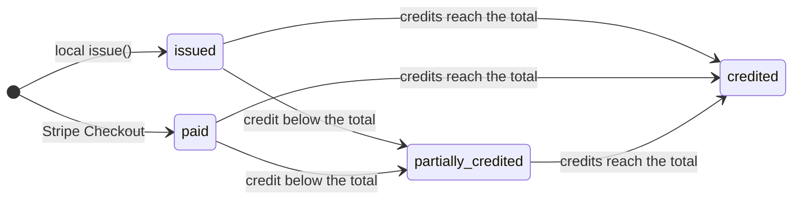
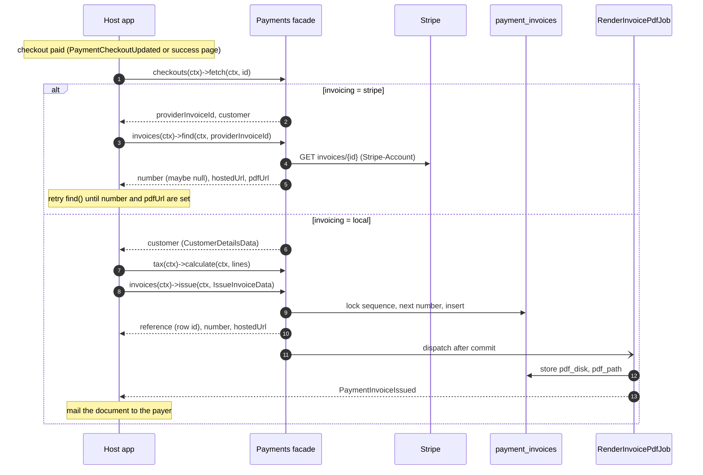

# Invoices

[Home](Home.md) › Invoices

## Contract

```php
interface ProvidesInvoices
{
    /** True when the provider creates the invoice inside its checkout; the app then only reads it. */
    public function isHandledByCheckout(): bool;
    public function issue(PaymentContext $context, IssueInvoiceData $data): InvoiceData;
    public function find(PaymentContext $context, string $invoiceReference): InvoiceData;
    /**
     * Credits (part of) an invoice after a refund and returns the credit note. The amount can not exceed what is
     * left to credit. Pass the provider's refund id so the credit note is linked to that refund instead of refunding again.
     */
    public function creditNote(
        PaymentContext $context,
        string $invoiceReference,
        int $amount,
        ?string $providerRefundId = null,
    ): InvoiceData;
}
```

Picked by `$context->sources->invoicing`.

| Method | `StripeInvoiceDriver` | `LocalInvoiceDriver` |
| --- | --- | --- |
| `isHandledByCheckout()` | `true` | `false` |
| `issue()` | throws `HandledByCheckoutException('Invoicing')` | creates a numbered invoice in `payment_invoices` and queues its PDF |
| `find()` | retrieves the Stripe invoice | reads the row by id (invoice or credit note) |
| `creditNote()` | creates a Stripe credit note (Credit Notes API), linked to the refund when `$providerRefundId` is given, and dispatches `PaymentInvoiceIssued` | creates a credit note document with its own number, updates the invoice's status and queues the credit note's PDF |

Both drivers return the **credit note** from `creditNote()`, not the invoice.

### InvoiceData

| Property | Type | Stripe | Local |
| --- | --- | --- | --- |
| `source` | `CapabilitySource` | `stripe` | `local` |
| `reference` | `string` | invoice id (`in_...`) or credit note id (`cn_...`) | the row id, as string |
| `number` | `?string` | Stripe's number; `null` until finalized | e.g. `INV-2026-0001` or `CN-2026-0001` |
| `status` | `string` | see [Statuses](#statuses) | see [Statuses](#statuses) |
| `hostedUrl` | `?string` | invoice: `hosted_invoice_url`; credit note: `null` | signed URL of `payments.documents.show` |
| `pdfUrl` | `?string` | invoice: `invoice_pdf`; credit note: the credit note's `pdf` | signed URL of `payments.documents.pdf`; `null` until the PDF is stored |
| `type` | `string` | `invoice` (from `find()`) or `credit_note` (from `creditNote()`) | `invoice` or `credit_note` |
| `creditsReference` | `?string` | for a credit note: the invoice id it credits | for a credit note: the id of the invoice it credits |

`reference` is what the app stores and passes back to `find()` and `creditNote()`.

### Statuses

Both drivers report the same statuses for a credited invoice:



| Driver | How the status is derived |
| --- | --- |
| Stripe `find()` | `credited` when `post_payment_credit_notes_amount` is above 0 and at least the invoice `total`; `partially_credited` when it is above 0 but lower; otherwise Stripe's own status (`draft`, `open`, `paid`, ...). |
| Local | Stored on the row: `issued` on issue; after a credit note `credited` when `credited_amount >= total`, otherwise `partially_credited`. |

A credit note itself has status `issued` (local) or Stripe's credit note status (Stripe).

## Customer details

`StripeCheckoutDriver` always asks the customer for billing details, whatever the invoicing source: `customer_creation: always`, `billing_address_collection: required` and `tax_id_collection.enabled: true`. `ProviderCheckoutData::$customer` returns them as `CustomerDetailsData` (`null` while the session has no `customer_details`):

| Property | Stripe field |
| --- | --- |
| `name` | `customer_details.name` |
| `email` | `customer_details.email` |
| `companyName` | `customer_details.business_name` |
| `addressLine1`, `addressLine2` | `customer_details.address.line1`, `line2` |
| `postalCode`, `city` | `customer_details.address.postal_code`, `city` |
| `country` | `customer_details.address.country` (ISO 3166-1 alpha-2) |
| `taxIdType`, `taxIdValue` | the first of `customer_details.tax_ids` (`type`, e.g. `eu_vat`, and `value`) |

Pass them into `IssueInvoiceData::$customer` so a local invoice prints the same company details as a Stripe invoice.

## Stripe invoices

With `invoicing = stripe`, `StripeCheckoutDriver` turns on `invoice_creation`. Stripe creates, numbers, renders and emails the invoice as part of the paid Checkout Session, on the connected account, with:

- `description` and `footer` (`CreateCheckoutData::$invoiceFooter`), `metadata`;
- `rendering_options.amount_tax_display: include_inclusive_tax`;
- the Stripe customer and tax id from Checkout (see [Customer details](#customer-details)).

After payment, `ProviderCheckoutData::$providerInvoiceId` holds the invoice id. Stripe finalizes the invoice shortly after the payment, so `number` and `pdfUrl` can be `null` on the first `find()`. Call `find()` again later (the reference host app re-syncs until the number and PDF link are present).

The account holder's Stripe email settings decide whether Stripe emails the invoice; the API does not expose that setting. The package does not dispatch `PaymentInvoiceIssued` for Stripe invoices.

### Stripe credit notes

```php
$creditNote = Payments::invoices($context)->creditNote(
    $context,
    $invoiceReference,          // in_...
    $refund->amount,
    $refund->providerRefundId,  // re_...: link the existing refund
);
```

`StripeInvoiceDriver::creditNote()`:

1. Creates a credit note with `POST credit_notes {invoice, amount}` on the connected account (Credit Notes API). With `$providerRefundId` it adds `refunds: [{refund, amount_refunded}]`, so Stripe links the refund that already happened instead of refunding the amount again.
2. Retrieves the invoice.
3. Dispatches `PaymentInvoiceIssued` with the credit note, the invoice's `metadata['payment_uuid']` (or the invoice id when that key is missing) as reference, and the invoice's `customer_email`. Stripe does not email credit notes, so the app delivers them like local documents.
4. Returns `InvoiceData` with `type = credit_note`, `reference` = the credit note id, `number`, `status`, `pdfUrl` = the credit note's `pdf`, `hostedUrl = null` and `creditsReference` = the invoice id.

## Local invoices

The local driver issues invoices and credit notes as documents of their own: a gapless number per series and year, a hosted page and a PDF behind signed links, and an event when the document is ready to send. Amounts are always positive; `type` says whether a row is an invoice or a credit note.

### Issuing

```php
$lines = Payments::tax($context)->calculate($context, [
    new TaxableLineData('Desk 4.12, 09:00 - 12:00', 2160, 'workspace_rental'),
]);

$invoice = Payments::invoices($context)->issue($context, new IssueInvoiceData(
    payerName: 'Guest Name',
    payerEmail: 'guest@example.com',
    lines: $lines,                  // TaxedLineData[], after any discount
    discountAmount: 240,            // printed as a discount line
    currency: 'eur',
    reference: $payment->uuid,      // what the invoice is for in the app
    customer: $checkout->customer,  // CustomerDetailsData from Checkout, optional
));
```

`LocalInvoiceDriver::issue()`:

1. Throws `RuntimeException('Local invoices need an issuer.')` when `$context->issuer` is `null`.
2. Opens a transaction on `payments.connections.tenant`.
3. Takes the next number of the invoice series (`payments.local.invoice_number_prefix`) from `DocumentNumberer` (see [Numbering](#numbering)).
4. Creates the row:

| Column | Value |
| --- | --- |
| `type` | `invoice` |
| `number` | e.g. `INV-2026-0001` |
| `status` | `issued` |
| `reference` | `IssueInvoiceData::$reference` |
| `issuer` | `$context->issuer->toArray()` (snapshot: name, address, chamberOfCommerceNumber, vatNumber) |
| `payer_name`, `payer_email` | from the data |
| `payer` | `IssueInvoiceData::$customer?->toArray()` |
| `lines` | each `TaxedLineData::toArray()` |
| `discount_amount` | from the data |
| `tax_amount` | sum of line `taxAmount` |
| `total` | sum of line `amount` (lines are already after discount) |
| `currency` | from the data |
| `issued_at` | `now()` |

5. After the transaction commits, dispatches `RenderInvoicePdfJob` (see [PDF](#pdf)).
6. Returns `InvoiceData` with `reference` = the row id, a signed `hostedUrl`, and `pdfUrl = null` (the PDF is not rendered yet).

### Numbering

`NetOS\Payments\Support\DocumentNumberer::next($series, $issuedAt)` hands out the next number of a series per year from `payment_document_sequences`:

1. `firstOrCreate` the row for `series` and the year of `$issuedAt`.
2. Locks it with `lockForUpdate()` and increments `last_number`.
3. Formats `{series}-{year}-{number}`, the number padded to 4 digits and longer when needed (`INV-2026-9999` is followed by `INV-2026-10000`).

Invoices use the series `payments.local.invoice_number_prefix` (default `INV`), credit notes `payments.local.credit_note_number_prefix` (default `CN`). The driver calls it inside its transaction on the tenant connection, so a rolled back document frees its number and numbering stays gapless.

### Finding

`find($context, $reference)` loads the row with `findOrFail($reference)` and returns it through `LocalDocumentPresenter`, with freshly signed links. It reads invoices and credit notes alike.

### Crediting

```php
$creditNote = Payments::invoices($context)->creditNote($context, $invoice->reference, 2160);
```

`LocalInvoiceDriver::creditNote()` ignores `$providerRefundId` and, in a transaction on the tenant connection:

1. Loads the invoice with `type = invoice` and `lockForUpdate()` (`ModelNotFoundException` for an unknown id or a credit note id).
2. Throws `InvalidArgumentException('Credit exceeds the remaining amount.')` when `$amount <= 0` or `$amount > total - credited_amount`.
3. Creates a credit note row: `type = credit_note`, `credits_invoice_id` = the invoice, a number from the credit note series, `status = issued`, the invoice's `reference`, `issuer`, `payer_name`, `payer_email`, `payer` and `currency`, `discount_amount = 0`, `total = $amount` (positive), and its own lines.
4. Updates the invoice: `credited_amount += $amount`, `credited_at = now()`, `status` = `credited` when `credited_amount >= total`, otherwise `partially_credited`.

After the commit it dispatches `RenderInvoicePdfJob` for the credit note and returns the credit note's `InvoiceData` (`type = credit_note`, `creditsReference` = the invoice id).

The credit note's lines: one line per VAT rate of the invoice, described as `Refund for invoice {number}`. The driver first works out what is left per rate: the invoice's gross amount and VAT per rate, minus the lines of earlier credit notes on that invoice. Rates with nothing left are dropped.

- **Full credit** (`$amount` equals what is left): each line mirrors the remaining gross amount and the remaining VAT of its rate exactly, so the invoice's VAT is cancelled to the cent.
- **Partial credit**: the amount is split over the remaining rates in proportion to their gross amounts, by largest remainder (each share is rounded down and the leftover cents go to the largest remainders), so no line is negative. Each line's `taxAmount` is the inclusive VAT of its amount. Rates whose share is `0` get no line.

The invoice itself is never edited beyond `credited_amount`, `credited_at` and `status`; a refund adds a credit note.

### Hosted page and PDF

`NetOS\Payments\Support\LocalDocumentPresenter::present($document, $urlParameters)` turns a `PaymentInvoice` into `InvoiceData` with signed links **without expiry**, like a provider's hosted invoice link:

| Link | Route name | Path | Present |
| --- | --- | --- | --- |
| `hostedUrl` | `payments.documents.show` | `GET {routes.documents_prefix}/{document}` | always |
| `pdfUrl` | `payments.documents.pdf` | `GET {routes.documents_prefix}/{document}/pdf` | once `pdf_path` is set |

The parameters are `document` (the row id) plus `PaymentContext::$urlParameters`, so a host app can add e.g. the tenant id and read it in a middleware from `payments.routes.documents_middleware`. See [Payment Context](Payment-Context.md).

The routes (`routes/documents.php`) use the `signed` middleware followed by `payments.routes.documents_middleware`, and are served by `NetOS\Payments\Http\Controllers\DocumentController`:

| Action | Behavior |
| --- | --- |
| `show($document)` | Renders the view `payments::invoices.document` for the row, with a signed PDF link (same query parameters) when the PDF exists. |
| `pdf($document)` | Streams the stored PDF inline as `{number}.pdf` from `pdf_disk`; 404 until the PDF is stored, and 404 when the stored file is missing from the disk. |

The view prints: "Invoice" or "Credit note" and the number; the issuer (name, address, Chamber of Commerce number, VAT number); the payer (company name, name, email, address, VAT id) from `payer`, falling back to `payer_name` and `payer_email`; the issue date; for a credit note the number of the credited invoice; the lines with VAT percentage and amount incl. VAT; a discount line when `discount_amount > 0`; the total incl. VAT and the VAT per rate; and the reference. Credit note amounts are shown negative, while the row stores them positive. Publish the view with the `payments-views` tag to change it (see [Configuration](Configuration.md#views)).

### PDF

`NetOS\Payments\Jobs\RenderInvoicePdfJob($documentId, $urlParameters)` runs on `payments.queue` (`$tries = 3`, `$backoff = [10, 60]`):

1. Loads the document.
2. When `pdf_path` is still `null`: renders `payments::invoices.document` with `spatie/laravel-pdf` (`Pdf::view(...)->format('a4')`), using the driver configured for that package in the host app, and saves it on the disk `payments.local.invoice_disk` at `invoices/{year}/{number}-{16 random characters}.pdf`. Then stores `pdf_disk` and `pdf_path` on the row. A retry does not render again once the path is stored.
3. Dispatches `PaymentInvoiceIssued` with the document (through `LocalDocumentPresenter`), its `reference`, `payer_email`, `pdf_disk` and `pdf_path`.

The random part keeps paths unique when several apps or tenants share one disk.

### Delivery

The package sends no mail. The host app listens to `PaymentInvoiceIssued` and sends the document to the payer, for example with the PDF attached from `$event->pdfDisk` / `$event->pdfPath` and a link to `$event->document->hostedUrl`. See [Webhooks](Webhooks.md#events).

| Document | Who sends it | `PaymentInvoiceIssued` |
| --- | --- | --- |
| Local invoice | the host app | after the PDF is stored |
| Local credit note | the host app | after the PDF is stored |
| Stripe invoice | Stripe (depending on the account's email settings) | not dispatched |
| Stripe credit note | the host app | right away, from `creditNote()`; `pdfDisk` and `pdfPath` are `null`, use `$event->document->pdfUrl` |

### IssuerData

```php
class IssuerData extends Data
{
    public function __construct(
        public string $name,
        public ?string $address = null,
        public ?string $chamberOfCommerceNumber = null,
        public ?string $vatNumber = null,
    ) {}
}
```

Provided by the app through `ProvidesIssuer` and placed on the context. The issuer is copied into each invoice (and from there into its credit notes), so later changes to the merchant's details do not alter issued documents.

## Flow per source



## Remembering the source

The app must remember which source each invoice came from, because the merchant can switch later. Rebuild the context with `withInvoicingSource()` to read or credit an older invoice. The reference app stores `invoice_source` and the invoice reference on its own `payments` table.
