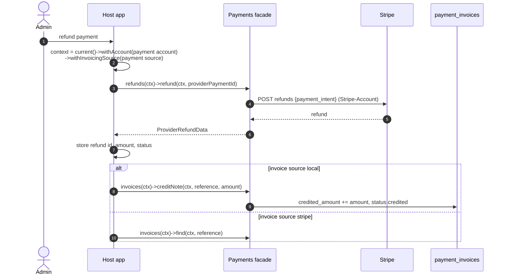

# Refunds

[Home](Home.md) › Refunds

## Contract

```php
interface IssuesRefunds
{
    /** Returns money of a payment to the customer; the whole payment when no amount is given. */
    public function refund(PaymentContext $context, string $providerPaymentId, ?int $amount = null): ProviderRefundData;
}
```

Picked by `$context->provider`. Only `StripeRefundDriver` exists.

## Stripe

```php
$refund = Payments::refunds($context)->refund($context, $providerPaymentId);         // full
$refund = Payments::refunds($context)->refund($context, $providerPaymentId, 500);    // 5.00 in minor units
```

`StripeRefundDriver::refund()` calls `refunds.create(['payment_intent' => $providerPaymentId, 'amount' => $amount])` with `['stripe_account' => $context->requireAccount()]` (`amount` omitted when `null`). Because checkouts are direct charges on the connected account, the refund comes out of that account's balance. Stripe emails the refund receipt according to the account holder's email settings.

`$providerPaymentId` is the PaymentIntent id from `ProviderCheckoutData::$providerPaymentId`.

### ProviderRefundData

| Property | Type | Notes |
| --- | --- | --- |
| `providerRefundId` | `string` | `re_...` |
| `amount` | `int` | Minor units actually refunded. |
| `status` | `string` | Stripe's status, e.g. `succeeded`, `pending`, `failed`. |

Stripe errors (`ApiErrorException`) are not caught. A `pending` refund can still fail later; the package does not listen to refund webhooks (`charge.refund.updated`, `refund.*`), so the app does not hear about it unless it adds that itself.

## The account to refund on

Use the account the payment was made on, not the merchant's current account:

```php
$context = app(ResolvesPaymentContext::class)->current()->withAccount($payment->provider_account_id);
```

## Refunds and invoices

| Invoicing source of the payment | What to do after the refund |
| --- | --- |
| `stripe` | Nothing in the package; `creditNote()` is not implemented for Stripe and throws `LogicException`. Re-read the invoice with `find()` if you show its status. |
| `local` | Call `creditNote($context, $invoiceReference, $refund->amount)` to record the credit on the local invoice. |



## Not included

- No refund records in the package's tables; the app stores what it needs.
- No local refund driver.
- No partial-refund bookkeeping beyond what the app stores and `credited_amount` on local invoices.
- No discount code un-redeeming: a refunded one-time code stays used.
