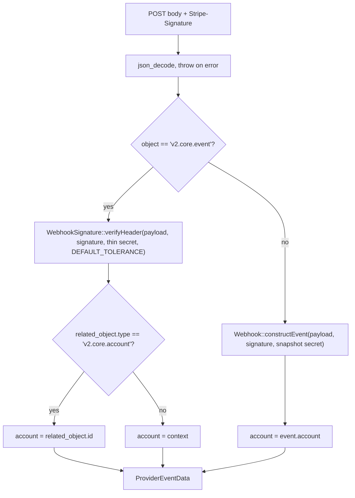
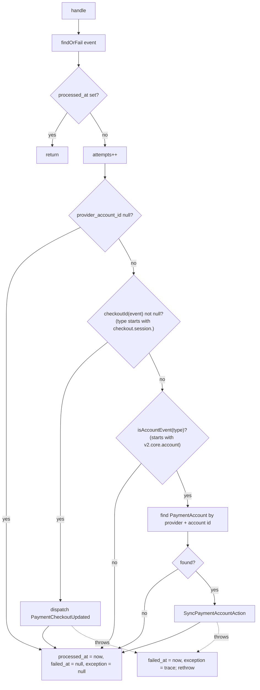

# Webhooks

[Home](Home.md) › Webhooks

## Route

`routes/webhooks.php`, loaded by the service provider:

```php
Route::post(config('payments.webhook_path') . '/{provider}', WebhookController::class)
    ->name('payments.webhooks');
```

With the default `webhook_path` the Stripe URL is `POST /payments/webhooks/stripe`.

The route has **no middleware group**: no session, no CSRF check, no `api` prefix, no throttle, no tenancy middleware. The route path is read from config when routes load, so a cached route file must be rebuilt after changing `webhook_path`.

## Contract

```php
interface TranslatesWebhooks
{
    /** Verifies the request's signature and maps it to a provider-neutral event. */
    public function translate(Request $request): ProviderEventData;

    /** Whether the event says something changed on a payment account. */
    public function isAccountEvent(string $type): bool;

    /** The checkout the event is about, or null when it is not a checkout event. */
    public function checkoutId(ProviderEventData $event): ?string;
}
```

`Payments::webhooks(Provider $provider = Provider::STRIPE)` returns the driver.

### ProviderEventData

| Property | Type | Notes |
| --- | --- | --- |
| `provider` | `Provider` | |
| `providerEventId` | `string` | `evt_...` |
| `type` | `string` | e.g. `checkout.session.completed`, `v2.core.account.updated` |
| `providerAccountId` | `?string` | The connected account the event is about, or `null` for platform events. |
| `payload` | `array<string, mixed>` | The decoded request body. |

## Controller

`NetOS\Payments\Http\Controllers\WebhookController::__invoke(Request $request, string $provider)`:

| Step | Result |
| --- | --- |
| `Provider::tryFrom($provider)` fails | `404` |
| `translate()` throws `SignatureVerificationException` or `UnexpectedValueException` | `400` |
| `PaymentWebhookEvent::firstOrCreate(['provider', 'provider_event_id'], ['type', 'provider_account_id', 'payload'])` | stored on the central connection |
| row was just created | `ProcessWebhookEventJob::dispatch($event->id)` |
| row already existed (duplicate delivery) | not dispatched again |
| always (when the above succeed) | `204 No Content` |

A body that is not valid JSON makes `json_decode(..., JSON_THROW_ON_ERROR)` throw `JsonException`, which the controller does not catch, so it results in a `500` rather than a `400`.

## Stripe signature verification

`StripeWebhookDriver` accepts both Stripe payload styles on one route and verifies each against the secret of its own event destination.



| Payload style | Detected by | Secret | Account id |
| --- | --- | --- | --- |
| Thin (v2) | `object = v2.core.event` | `payments.stripe.webhook_secrets.thin` | `related_object.id` when it is a `v2.core.account`, else `context` |
| Snapshot (v1) | anything else | `payments.stripe.webhook_secrets.snapshot` | `event.account` (set for events from connected accounts) |

A missing secret becomes an empty string, so every event of that style fails verification with `400`. The default Stripe tolerance (300 seconds) applies to both.

For thin events the package stores the thin payload as is and does not fetch the full event; account events are handled by re-reading the account.

## Storage

Events are stored in `payment_webhook_events` on the central connection, unique on `(provider, provider_event_id)`. The table is the inbox: it keeps every verified event, processed or not, with `attempts`, `processed_at`, `failed_at` and `exception`. See [Data Model](Data-Model.md#payment_webhook_events).

## ProcessWebhookEventJob

`NetOS\Payments\Jobs\ProcessWebhookEventJob` (`ShouldQueue`, `Queueable`), queued on `payments.queue`, carries only the event row id.



- Events without a connected account (platform events) are marked processed and skipped.
- Unknown types are marked processed and skipped.
- Listener exceptions for `PaymentCheckoutUpdated` propagate into the job (events are dispatched synchronously), mark the row failed and are rethrown so the queue retries according to the worker's `--tries` / backoff. The job sets no `$tries` itself.
- An already processed row is skipped, so retries and duplicate jobs are safe.
- The job does **not** initialize tenancy. Listeners must find the owner from the account id.

## Events

| Event | When | Properties |
| --- | --- | --- |
| `PaymentCheckoutUpdated` | Every `checkout.session.*` event from a connected account | `Provider $provider`, `string $providerAccountId`, `string $providerCheckoutId` |
| `PaymentAccountUpdated` | Every `SyncPaymentAccountAction` run (from webhooks and from the app) | `PaymentAccount $account` |

`PaymentCheckoutUpdated` deliberately carries ids only: the package does not know what was paid for. The listener fetches the checkout (`Payments::checkouts($ctx)->fetch(...)`) and updates the app's own records.

### Tenancy in listeners

Webhook events arrive without tenancy. The listener uses the central `PaymentAccount` to find the owner, then runs inside the owner's context. With stancl/tenancy:

```php
use NetOS\Payments\Events\PaymentCheckoutUpdated;
use NetOS\Payments\Models\PaymentAccount;

class SyncPaymentOnCheckoutUpdated
{
    public function handle(PaymentCheckoutUpdated $event): void
    {
        $account = PaymentAccount::query()
            ->where('provider', $event->provider)
            ->where('provider_account_id', $event->providerAccountId)
            ->first();

        if (! $account?->owner instanceof Tenant) {
            return;
        }

        $account->owner->run(function () use ($event): void {
            $payment = Payment::query()->where('provider_checkout_id', $event->providerCheckoutId)->first();

            if ($payment !== null) {
                SyncPaymentAction::make()->handle($payment); // fetch checkout, mark paid, invoice
            }
        });
    }
}
```

`PaymentAccount` must be on the central connection (`payments.connections.central`) for this lookup to work outside tenancy.

## Stripe setup

### Event destinations

Create two event destinations (Stripe dashboard → Developers → Webhooks → Add destination), both with the endpoint URL `https://<your-host>/payments/webhooks/stripe`:

| | Destination 1 | Destination 2 |
| --- | --- | --- |
| Events from | Connected accounts | Your account |
| Payload style | Snapshot | Thin |
| API version | the version your `stripe-php` uses | n/a |
| Events | `checkout.session.completed`, `checkout.session.expired`, `checkout.session.async_payment_succeeded`, `checkout.session.async_payment_failed` | `v2.core.account.updated` and the `v2.core.account[...]` events you need, such as requirement and capability status updates |
| Signing secret → | `STRIPE_WEBHOOK_SECRET` | `STRIPE_THIN_WEBHOOK_SECRET` |

Any `checkout.session.*` type produces `PaymentCheckoutUpdated`; any type starting with `v2.core.account` triggers an account sync. Other types are stored and skipped, so subscribing to extra events only costs storage.

### Local development with the Stripe CLI

Forward both streams to your local app:

```bash
stripe listen \
  --forward-connect-to http://localhost:8000/payments/webhooks/stripe \
  --events checkout.session.completed,checkout.session.expired,checkout.session.async_payment_succeeded,checkout.session.async_payment_failed

stripe listen \
  --forward-thin-to http://localhost:8000/payments/webhooks/stripe \
  --thin-events 'v2.core.account.updated'
```

`stripe listen` prints a `whsec_...` signing secret for the session. Put it in `STRIPE_WEBHOOK_SECRET` and, for the thin stream, `STRIPE_THIN_WEBHOOK_SECRET`, then clear the config cache. Flag names depend on the CLI version; check `stripe listen --help`. Make sure a queue worker runs the `payments` queue, or nothing is processed.

Trigger a test event: `stripe trigger checkout.session.completed --stripe-account acct_...`.

## Operations

- **Inspecting:** query `payment_webhook_events` for rows with `failed_at` set, or with `processed_at` null and an old `created_at`.
- **Reprocessing:** there is no command. Re-dispatch manually, e.g. `ProcessWebhookEventJob::dispatch($id)`; processed rows are skipped.
- **Stuck rows:** if dispatching the job fails after the row was stored (for example the queue connection is down), the request returns an error, Stripe redelivers, `firstOrCreate()` finds the existing row and the job is not dispatched again. Such rows stay unprocessed until re-dispatched by hand.
- **Retention:** rows are never deleted by the package. Prune them in the app if needed (they contain customer emails and names from Stripe payloads).
